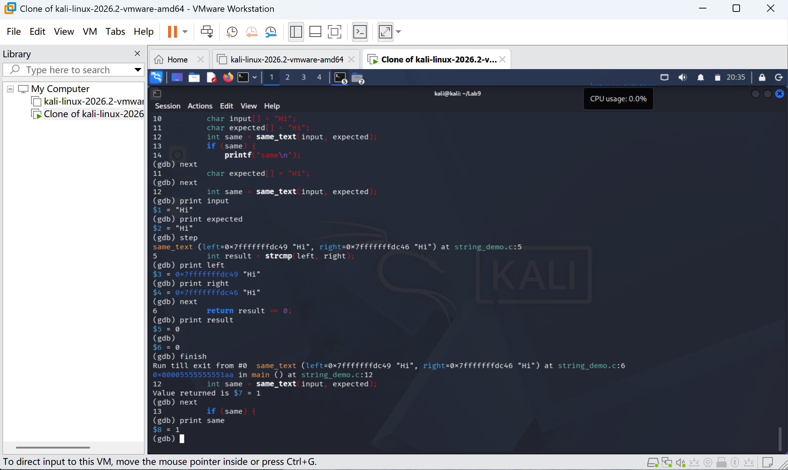
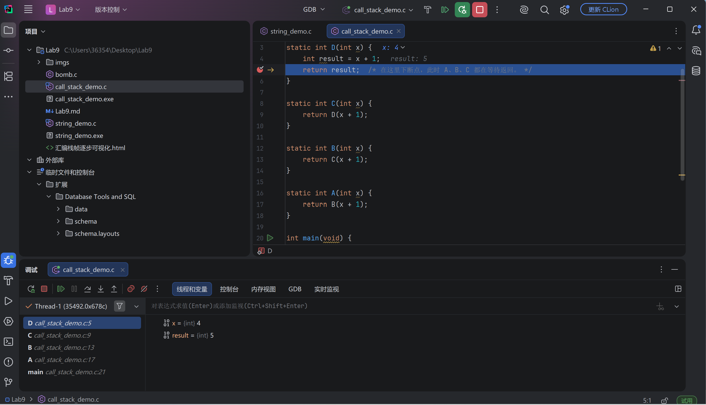
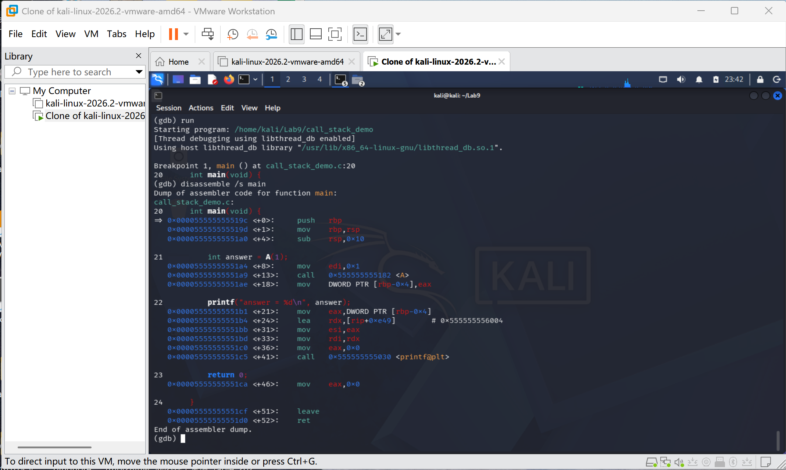
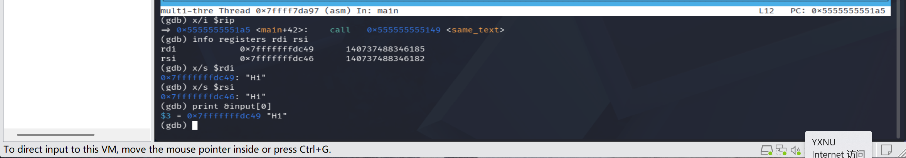
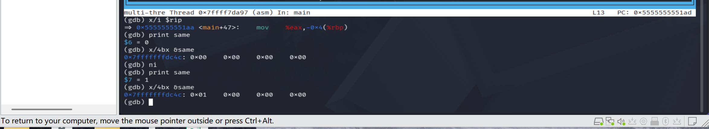

# Lab9　用 GDB 读懂一次函数调用

在 Kali 中运行 `string_demo.c`，先用源码单步找出两个字符串的比较结果，再用机器指令解释参数怎样传入、函数怎样返回，以及 CPU 怎样选择输出分支。最后阅读 `bomb.c`，沿函数调用追踪两行输入。

在课程仓库本人的 `学号姓名/` 下创建 `Lab9/imgs/`，复制本手册到个人 `Lab9/`，在副本中填写本人记录。最终提交**填写后的报告、一张 CLion 调用栈截图和四张 GDB 截图，共 6 个文件**。截图按操作处给出的文件名保存，完整目录树见文末“文件提交与截止时间”。

> 本人姓名、10 位学号：李林轩 2026010006

## 一、用 GDB 调试字符串程序

### 1.1 准备 Kali 环境与源码

以下命令在 **Kali 终端**逐条输入，不包含提示符：

```bash
uname -s
uname -m
pwd
sudo apt update
sudo apt install -y gcc gdb
mkdir -p ~/Lab9
cd ~/Lab9
```

系统应为 `Linux`，架构应为 `x86_64`。`~` 是用户主目录，`mkdir -p` 创建目录，`cd` 切换目录，`pwd` 显示当前位置。后续实验使用固定目录，避免找错文件。编译和调试不使用 `sudo`。

若显示 `aarch64`，应由教师准备兼容的 x86-64 Linux 环境；不能将本手册的寄存器和指令直接套在 ARM 程序上。

> 本人系统与架构：Linux /x86_64

将 Lab8 6.4 已学习的 [string_demo.c](../../homework/Lab9/string_demo.c) 放入 Kali 的 `~/Lab9/`，确认 `input`、`expected` 均为 `"Hi"`。复制方式与 Lab8 第六步相同，只是文件换成 `string_demo.c`；编译时增加 `-g -O0` 以便调试。使用 Remote-SSH 时在远程文件夹中创建该文件并复制给定源码即可。也可以在 **Windows Git Bash 的课程仓库根目录**执行，替换用户名及 IP：

```bash
scp homework/Lab9/string_demo.c kali@虚拟机IP:~/Lab9/
```

回到 Kali 执行：

```bash
cd ~/Lab9
ls -l
cat string_demo.c
gcc -g -O0 -o string_demo string_demo.c
./string_demo
```

`gcc` 将源码生成可执行文件；`-g` 保留调试信息，`-O0` 便于按源码观察，`-o` 指定输出名，`./` 表示当前目录。预期输出为 `same`。修改源码后必须重新编译。

### 1.2 先复习字符数组与字符串

先回顾 [Lab8 6.4](../../homework/Lab8/Lab8.md#64-课堂短练习字符数组字符串参数与比较结果) 中已经运行和调试过的程序：

- `input` 和 `expected` 各保存 `48 69 00`，末尾的 `00` 是字符串结束符。
- `same_text` 的 `left`、`right` 接收两个首字符地址，再交给 `strcmp` 比较内容。
- 两串相同时，`strcmp` 返回 0，`same_text` 返回 1；不同则分别为非零和 0。

保留两个 `"Hi"`，在 GDB 中核对这三个结果。

### 1.3 区分三个输入位置

| 当前状态 | 输入内容 |
| :--- | :--- |
| Kali Shell 提示符 | `cd`、`gcc`、`gdb` 等终端命令 |
| `(gdb)` 提示符 | 断点、执行、查看内存等调试命令 |
| 程序正在等待输入，没有 `(gdb)` 提示符 | 程序要求的输入文字（Lab10 会用到） |

先看提示符，再输入对应的命令。

### 1.4 在练习程序上逐条走完第一次调试

用下表查找常用操作。

| CLion 操作 | GDB 命令 | 含义 |
| :--- | :--- | :--- |
| 下断点（行号左侧红点） | `break main` | 在函数入口停下，不必指定行号 |
| 启动调试（Shift+F9） | `run` | 带调试器运行，遇到断点停住 |
| Step Over（F8） | `next` | 执行当前源码语句，不进入调用内部 |
| Step Into（F7） | `step` | 进入有源码可调试的函数 |
| Step Out（Shift+F8） | `finish` | 执行完当前函数并返回调用者 |
| Resume（F9） | `continue` | 继续执行到下一个断点或结束 |
| 悬停变量 / Variables | `print 表达式` | 读取指定变量或表达式 |
| 展开数组或指针看字符串 | `x/s 地址或变量` | 把该地址处按字符串显示 |
| Stop（Ctrl+F2） | `quit` | 结束调试，退出调试器 |


在 Kali 终端切换到练习目录：

```bash
cd ~/Lab9
```

预期：没有任何输出，提示符回到下一行。

作用：把当前目录换成放有 `string_demo` 的目录；后面的 `./string_demo` 指当前目录下的文件，目录不对就找不到。

在 Kali 终端启动 GDB：

```bash
gdb -q ./string_demo
```

预期：先打印 `Reading symbols from ./string_demo...`，最后一行是 `(gdb)`。

作用：`-q` 省掉版权说明，`./string_demo` 是要调试的程序。从出现 `(gdb)` 开始，输入的每一行都按调试命令解释。

以下 16 条在 `(gdb)` 提示符下逐条输入。每条只敲一行，先对照“预期”，一致再敲下一条。地址与行号由编译器和 GDB 版本决定，你的可能不同；只要指令结构和显示的文字对得上就算正常。

**第 1 条：关闭分页**

```gdb
set pagination off
```

预期：没有输出，提示符仍是 `(gdb)`。

作用：关闭分页后，长输出会连续显示。

**第 2 条：在 `main` 入口下断点**

```gdb
break main
```

预期：`Breakpoint 1 at 0x1183: file string_demo.c, line 10.`

作用：在 main 的第一条可调试源码语句处设断点。GDB 为断点分配编号，地址随编译结果变化。

**第 3 条：运行**

```gdb
run
```

预期：

```text
Starting program: /home/kali/Lab9/string_demo

Breakpoint 1, main () at string_demo.c:10
10	    char input[] = "Hi";
```

作用：程序在第 10 行执行前暂停，此时 input 尚未初始化。

**第 4 条：查看源码**

```gdb
list
```

预期：打印 `string_demo.c` 中当前行上下共十行左右，行号约从 5 到 14，能看到 `same_text` 的定义和 `main` 的开头。

作用：显示当前位置附近的源码和行号。

**第 5 条：执行 `input` 的初始化**

```gdb
next
```

预期：`11	    char expected[] = "Hi";`

作用：执行当前行，初始化 input。GDB 显示接下来要执行的源码行。

**第 6 条：执行 `expected` 的初始化**

```gdb
next
```

预期：`12	    int same = same_text(input, expected);`

作用：初始化 expected，停在调用 same_text 的语句上。

**第 7 条：查看第一个数组**

```gdb
print input
```

预期：`$1 = "Hi"`

作用：按变量类型打印 input。GDB 将字符数组显示为字符串。

**第 8 条：查看第二个数组**

```gdb
print expected
```

预期：`$2 = "Hi"`

作用：查看 expected。$1、$2 是打印结果的历史编号。

**第 9 条：进入被调用的函数**

```gdb
step
```

预期：

```text
same_text (left=0x7fffffffe0a9 "Hi", right=0x7fffffffe0a6 "Hi") at string_demo.c:5
5	    int result = strcmp(left, right);
```

作用：进入 same_text。括号中列出两个指针参数的值及其指向的字符串。

**第 10 条：查看第一个参数**

```gdb
print left
```

预期：`$3 = 0x7fffffffe0a9 "Hi"`

作用：left 保存第一个数组首字符的地址。

**第 11 条：查看第二个参数**

```gdb
print right
```

预期：`$4 = 0x7fffffffe0a6 "Hi"`

作用：right 保存第二个数组首字符的地址。比较两次输出，同样的文字可以位于不同地址。

**第 12 条：执行比较**

```gdb
next
```

预期：`6	    return result == 0;`

作用：执行 strcmp，将结果保存到 result。

**第 13 条：查看比较结果**

```gdb
print result
```

预期：`$5 = 0`

作用：两个字符串相等，strcmp 返回 0。

**第 14 条：执行完函数并返回**

```gdb
finish
```

预期：

```text
Run till exit from #0  same_text (left=0x7fffffffe0a9 "Hi", right=0x7fffffffe0a6 "Hi")
    at string_demo.c:6
0x00005555555551aa in main () at string_demo.c:12
12	    int same = same_text(input, expected);
Value returned is $6 = 1
```

作用：完成 same_text 并返回 main。表达式 result == 0 成立，因此函数返回 1。

**第 15 条：把返回值存进 `same`**

```gdb
next
```

预期：`13	    if (same) {`

作用：执行赋值。刚才 finish 停在调用返回处，此时执行余下的语句将返回值保存到 same。

**第 16 条：查看 `same`**

```gdb
print same
```

预期：`$7 = 1`

作用：核对 same 的值，预测下一步将走哪个分支。

本人 GDB 调试截图：保存 `imgs/lab9_gdb.png`。图中应能辨认第 9～16 条的命令和输出，即 `step` 进入 `same_text` 时显示的两个参数、`finish` 打印的返回值和 `print same` 的结果。



先不要退出 GDB：执行完 `print same` 后仍停在 `main` 中，两个数组已经初始化。下一节直接在这个暂停状态读取内存字节。

### 1.5 把文字与内存字节对应起来

接着上一节的暂停状态执行，两个数组已经初始化。如果已经退出 GDB，按 1.4 的做法重新进入调试，再用那 16 条中的第 1～6 条回到停在 `int same = ...` 的位置。

**第 1 条：按字符串读取**

```gdb
x/s input
```

预期：`0x7fffffffe0a9:	"Hi"`

作用：`x` 表示查看内存，`s` 表示按字符串显示，即从这个地址开始读，读到结束符为止。

**第 2 条：按字节读取**

```gdb
x/3bx input
```

预期：`0x7fffffffe0a9:	0x48	0x69	0x00`

作用：`3` 是读三个单元，`b` 是每个单元一字节，`x` 用十六进制显示。`0x48`、`0x69` 正是 `H`、`i` 的编码，`0x00` 是结束符。

同一条 `x` 命令只换一个格式字母，输出就完全不同：`s` 看到文字，`b` 看到字节。GDB 把每个字节显示成带 `0x` 的形式；本文正文有时简写成 `48`，指的是同一个字节。

仍然不要退出 GDB。下一节在同一个会话里把程序从头再跑一遍，观察调用前的机器指令，不需要修改源码或重新编译。

## 二、逐条读懂 main 的 25 条机器指令

### 2.1 一个程序在哪里保存数据？

把地址想成字节的门牌号。一个地址标识一个字节，相邻两个字节的地址相差 1。程序启动时，操作系统为进程建立虚拟地址空间，装入程序与所需的库。下表列出读这段程序会遇到的几类区域。

| 区域 | 用途 | 本例中能看到什么 |
| --- | --- | --- |
| 代码区 | 存放 CPU 要执行的机器指令 | GDB 显示的 `main`、`same_text` 的指令地址 |
| 只读数据区 | 存放运行期间只需读取的数据 | 输出时用到的字符串常量 `"same"`、`"different"` |
| 可写静态数据区 | 存放生命周期贯穿程序运行的全局变量和静态变量，包括零初始化区 | 如果在函数外定义 `int count;`，它通常在零初始化区 |
| 堆 | 为运行时申请的数据提供空间 | 本例的 C 源码没有显式调用 `malloc` |
| 栈 | 为正在进行的函数调用保存返回地址、需要保留的寄存器值以及部分局部数据 | 本次编译把两个字符数组和整数 `same` 放在 `main` 的栈上 |

CPU 里还有一些很小的存储位置，叫**寄存器**。例如，`rsp` 里装着一个地址，CPU 通过这个地址找到内存里的栈顶。读“寄存器里是什么”和读“那个地址处有什么”是两次不同的观察。

### 2.2 先在 CLion 看函数怎样一层层返回

打开 [call_stack_demo.c](../../homework/Lab9/call_stack_demo.c)。在一个单独的 C 可执行项目中，用它替换默认的 `main.c`，选 Debug 构建。在 `D` 内的 `return result;` 行下断点并启动调试。此时 `result` 已算好，`D` 还没有返回。

1. 从源码追踪调用顺序：`main → A(1) → B(2) → C(3) → D(4)`。进入下一层时，上一层仍要保留足够的信息，以便稍后接着执行。
2. 在调试窗口的 **Frames（调用栈）** 中，从当前帧往下读，会依次看到 `D、C、B、A、main`。点选 `D` 帧读出 `x = 4` 和 `result = 5`，再点选 `C` 帧读出 `x = 3`。这两个同名的 `x` 属于两次不同的函数调用。点选帧只改变查看位置。
3. 选回 `D` 帧，在执行 Step Out 前，只截取 CLion 调试窗口左下角的 **Frames（调用栈）** 面板。图中从上到下应能读出 `D → C → B → A → main` 五层，保存为 `imgs/lab9_call_stack.png`。

   

4. 执行 Step Out，观察当前帧回到 `C`。继续逐层返回，最后输出 `answer = 5`。最后进入的调用最先结束，这种顺序叫**后进先出**。每次调用为自己保留的一组栈上数据叫**栈帧**。

### 2.3 在真正的第一条指令停住

回到 1.5 的 GDB 会话。执行下面四条命令。`delete breakpoints` 清除前面设在源码行的断点，`break *main` 精确停在函数入口的第一条机器指令。遇到删除断点或重新运行的确认提示时输入 `y`。

```gdb
delete breakpoints
set disassembly-flavor intel
break *main
run
```

执行 `disassemble /s main`。拉高终端，把命令、开头的源码行以及 `call ... <same_text>` 一起截入 `imgs/lab9_disas.png`。



读一行示例：`0x000055555555517f <+4>: sub rsp,0x10`。左边是这条指令的地址，`+4` 表示它位于 `main` 起点之后 4 个字节。指令长度可以不同，因而下一行是 `+8`。本文用偏移定位你看到的那一版程序；其他编译结果请按源码行、操作数和函数名定位。`=>` 指向下一条要执行的指令。

在 GDB 中输入 `display/i $pc`，以后每次停下都会显示下一条指令。用 `nexti`（简写 `ni`）走一步；遇到函数调用时它会运行到返回处。另用浏览器打开本地的[汇编栈帧逐步可视化](../../homework/Lab9/汇编栈帧逐步可视化.html)，选择“1 · 相同”，点“重置”。从第 0 步开始，每次先预测，再点“下一步”。网页高亮刚执行的指令，GDB 的箭头指向接下来要执行的指令。对照时用指令和相对位置，实际栈地址按本人运行值读取。

### 2.4 第 9 行　进入 main，给这次调用留出空间

C 源码写着 `int main(void) {`。运行时代码调用了 main，CPU 已经知道去哪里执行第一条指令，也已经把 main 将来要返回的地址写在栈顶。执行 `info registers rsp rbp` 看入口状态，再执行 `x/gx $rsp` 读栈顶的 8 字节。这里的 `g` 指每次读 8 字节，最后的 `x` 指以十六进制显示。把读到的值记在草稿上，到第 25 条再找它。

以下用一组便于心算的示意地址贯穿整个调用。假定刚进入 main 时 `rsp = 0x1008`，在 GDB 和网页上用各自显示的实际地址做相同的加减。

#### 第 1 条　把上一层的 rbp 存起来

```asm
0x000055555555517b <+0>: push rbp
```

`push` 表示压栈。指令只写出了要保存的值 `rbp`，CPU 还会自动使用栈指针 `rsp`。在这里，rbp 是 64 位，保存它需要 8 个字节。栈向低地址增长，CPU 先把 rsp 从 `0x1008` 减到 `0x1000`，再把旧 rbp 的值写入 `0x1000～0x1007`。刚才看到的返回地址还在 `0x1008` 开始的位置。

为什么上来就要保存 rbp？main 接下来要把自己的地址写进这个寄存器，而调用约定要求 main 返回时恢复它原来的值。执行前用 `p/x $rbp` 看旧值，执行一次 `ni` 后用 `x/gx $rsp` 读新栈顶。两个数应该相等。网页上此时有 8 个字节被写入，rbp 寄存器本身仍保留原值。

#### 第 2 条　给 main 确定一个固定的参照地址

```asm
0x000055555555517c <+1>: mov rbp,rsp
```

Intel 写法把目的放在逗号左边。`mov rbp,rsp` 可以念作“把 rsp 的值复制给 rbp”。右边的 rsp 中装着 `0x1000`，执行后两个寄存器都装着 `0x1000`。操作数两侧都是寄存器，这一步只复制地址数值，栈里刚保存的 8 个字节保持原样。

为什么要两个寄存器指着同一处？下一步 rsp 会移动，后面调用函数时还会再移动。本次编译让 rbp 在 main 使用这块空间期间保持稳定，后面的指令便能用“距离 rbp 几个字节”定位变量。执行 `ni` 后用 `info registers rbp rsp` 核对两者相等。网页中的两个标记也会重合。

#### 第 3 条　为局部变量一次预留 16 个字节

```asm
0x000055555555517f <+4>: sub rsp,0x10
```

`sub rsp,0x10` 表示用 rsp 当前值减去右边的数，再把结果写回 rsp。`0x` 表示十六进制，`0x10` 等于十进制 16。于是 `rsp = 0x1000 − 16 = 0x0ff0`。从新栈顶 `0x0ff0` 到 `0x0fff`，恰好有 16 个字节可供 main 使用。

两个数组各占 3 字节，same 占 4 字节，共 10 字节。这里编译器选用 16 字节的空间，能放下这三个变量，也让稍后的函数调用保持所需的栈对齐。执行 `ni` 后用 `p/d $rbp-$rsp` 验证差为 16。网页只移动栈顶标记，因为这条指令的目的操作数是 rsp；给每个变量写初值要等后面的 mov。

| 相对 rbp 的范围（十进制） | 示意地址 | 用途 |
| --- | --- | --- |
| +8 到 +15 | 0x1008～0x100f | main 将来返回的地址 |
| 0 到 +7 | 0x1000～0x1007 | 旧 rbp |
| −4 到 −1 | 0x0ffc～0x0fff | same |
| −7 到 −5 | 0x0ff9～0x0ffb | input |
| −10 到 −8 | 0x0ff6～0x0ff8 | expected |
| −16 到 −11 | 0x0ff0～0x0ff5 | 其余预留空间 |

### 2.5 第 10、11 行　把两个字符数组写入各自的位置

#### 第 4 条　写入 input 的两个字符

```asm
0x0000555555555183 <+8>: mov WORD PTR [rbp-0x7],0x6948
```

源码 `char input[] = "Hi";` 要求数组里依次放 H、i 和结束符。先读目的操作数。`[rbp-0x7]` 给出写入的起始地址，即示例中的 `0x0ff9`。`WORD PTR` 指定这次内存操作宽 2 字节。右边的 `0x6948` 是直接编码在指令里的整数，低字节为 `48`，高字节为 `69`。

为什么把 i 的编码写在 H 的前面？x86-64 以小端序存放多字节整数，低字节落在低地址。执行一次 `ni`，用 `x/2bx $rbp-7` 从低到高读，应看到 `48 69`，按字符读就是 H、i。网页上点亮两个相邻的格子。这一步只完成了源码初始化的一部分。

#### 第 5 条　在 input 末尾写下结束符

```asm
0x0000555555555189 <+14>: mov BYTE PTR [rbp-0x5],0x0
```

`BYTE PTR` 只写一个字节。目的地址 `rbp−5` 等于 input 起点 `rbp−7` 加 2，正好是 `input[2]`。写入的数值 `0x0` 对应 C 的空字符 `'\0'`。可见字符 `'0'` 有自己的编码 `0x30`。

为什么两个可见字符要占三个字节？稍后比较函数拿到的是首字符地址，C 字符串约定用值为零的字节标记末尾。执行 `ni` 后用 `x/3bx input` 查看 `48 69 00`，再用 `x/s input` 看同一处显示为 `"Hi"`。后一个命令一直读到刚写下的结束符。

#### 第 6 条　在另一个地址写入 expected 的两个字符

```asm
0x000055555555518d <+18>: mov WORD PTR [rbp-0xa],0x6948
```

现在对应 `char expected[] = "Hi";`。`0xa` 是十进制 10，`[rbp-0xa]` 就是 `0x1000 − 10 = 0x0ff6`。右侧仍是 `0x6948`，WORD 仍是两字节，所以 `expected[0]` 和 `expected[1]` 分别得到 `48` 和 `69`。

为什么要再写一遍？源码定义了两个各自可修改的数组。第一个 H 已写在 `0x0ff9`，第二个 H 要写在 `0x0ff6`。执行 `ni`，用 `x/2bx expected` 和 `x/2bx input` 对照每行开头的地址。在网页的“十六进制矩阵”中点选两个 H，也能看到它们各自的地址。

#### 第 7 条　让 expected 成为完整的 C 字符串

```asm
0x0000555555555193 <+24>: mov BYTE PTR [rbp-0x8],0x0
```

目的地址 `rbp−8` 等于 expected 的起点 `rbp−10` 加 2。这里用 BYTE 写一个零。至此，expected 在 `0x0ff6～0x0ff8` 内有自己的结束符。这使比较函数可以独立判断第二个字符串在哪里结束。

执行 `ni`，用 `x/6bx expected` 看本次示例布局中相邻的六个字节。依次读出第一组 `48 69 00` 和第二组 `48 69 00`，再用 `x/s expected` 验证只显示一个 Hi。C 数组按地址递增排列字符；前面说的栈向低地址增长，描述的是压栈时 rsp 移动的方向。

### 2.6 第 12 行　把参数交给 same_text，再接住返回值

源码是 `int same = same_text(input, expected);`。先想象自己站在被调函数入口。它声明了两个指针形参 `left` 和 `right`，需要知道两个数组各从哪里开始。在这里使用的 Linux x86-64 调用约定中，调用者把这两个指针依次放进 rdi 和 rsi，被调函数通过 eax 交回 int 结果。下面跟着一个地址从数组起点走到参数寄存器。

#### 第 8 条　算出第二个数组的首地址

```asm
0x0000555555555197 <+28>: lea rdx,[rbp-0xa]
```

`lea` 意为“取有效地址”。先算方括号里的表达式 `rbp−10`，再把计算结果写到左边的 64 位寄存器 rdx。按前面的示意数值，rdx 得到 `0x0ff6`。两个字符仍留在栈上，稍后 same_text 可以循着地址读取它们。

执行 `ni` 后先用 `p/x $rdx` 看寄存器中那个数，再用 `x/bx $rdx` 读该地址处的一个字节。前者对应 `&expected[0]`，后者读到 `0x48`。同样写着方括号，上一条 mov 用它指定写入位置，这条 lea 只需要地址计算结果。

#### 第 9 条　算出第一个数组的首地址

```asm
0x000055555555519b <+32>: lea rax,[rbp-0x7]
```

`[rbp-0x7]` 给出 input 的起点。lea 把这个地址放到 rax，在示意布局中为 `0x0ff9`。编译器在这几条指令里暂用 rdx 和 rax 存两个地址，好让它们在准备参数时都能取到。

为什么先算第二个地址也可以？两个地址的计算都只依赖已经固定的 rbp。调用时排第几个参数，取决于最后放进哪个参数寄存器。执行 `ni` 后用 `p/x $rax` 和 `p/x &input[0]` 对照，此时箭头还没有到 call。

#### 第 10 条　把 expected 的地址交给第二个参数

```asm
0x000055555555519f <+36>: mov rsi,rdx
```

`mov rsi,rdx` 把 rdx 中的整个地址复制到 rsi。此处右侧没有方括号，CPU 直接读寄存器中的数。在示意布局里，复制完成后 rsi 和 rdx 都等于 `0x0ff6`，栈中的 expected 仍占原来的三个字节。

为什么目的选 rsi？调用方和被调方要事先约定参数的位置，本例第二个指针参数就用 rsi。执行 `ni` 后用 `info registers rsi rdx` 验证相等，再用 `x/s $rsi` 模拟被调方顺着地址读取第二个字符串。

#### 第 11 条　把 input 的地址交给第一个参数

```asm
0x00005555555551a2 <+39>: mov rdi,rax
```

`mov rdi,rax` 从 rax 取出刚算好的 `&input[0]` 写进 rdi。按调用约定，进入 same_text 时，形参 left 从 rdi 得到 input 的地址，right 从 rsi 得到 expected 的地址。若只看两次显示的 “Hi”，还无法区分哪个地址属于哪个数组。

执行 `ni`，箭头现在应指向 call。依次输入下面的查看命令，用地址把每个寄存器和对应数组配成一对。把命令和结果保存为 `imgs/lab9_regs.png`。

```gdb
x/i $rip
info registers rdi rsi
x/s $rdi
x/s $rsi
print &input[0]
print &expected[0]
```



#### 第 12 条　调用 same_text，并留下回来的位置

```asm
0x00005555555551a5 <+42>: call 0x555555555149 <same_text>
```

尖括号里的 `same_text` 是 GDB 为目标地址标出的函数名。CPU 离开 main 以前，需要留下一个问题的答案：执行完 same_text，要从 main 的哪里接着走？先执行 `x/2i $rip`，第一行是 call，第二行在本例中位于 `0x5555555551aa`（main+47）。第二行的地址就是这次调用的**返回地址**。

执行一次 `si`，进入函数入口。刚才的 call 做了两件事：把 rsp 从示意值 `0x0ff0` 减到 `0x0fe8`，从这个新栈顶开始写入 8 字节的返回地址；再把执行位置转到 `0x555555555149`。用 `x/gx $rsp` 读回那 8 个字节，与先前第二行的地址对照。执行 `bt`，此时最上层为 same_text，下一层为等待它返回的 main。

对照网页点击“下一步”，看 call 写入的 8 个字节，再走到模拟返回的一步。回到 GDB 执行 `finish`。same_text 在内部调用 strcmp，然后计算 `result == 0`。两串相等时，strcmp 给出 0，表达式为真，same_text 因此交回整数 1。它返回时从栈顶取回先前保存的地址，main 从 +47 恢复执行。**返回地址**决定去哪条指令，**返回值**在 eax 里，决定下一条指令有什么数据可用。

#### 第 13 条　把函数的整数结果写进局部变量 same

```asm
0x00005555555551aa <+47>: mov DWORD PTR [rbp-0x4],eax
```

你看到的 `=>` 如果就在这一行，说明 CPU 已回到 main，写入动作还在前面等着。`eax` 是 rax 的低 32 位；调用前 rax 曾临时保存一个地址，现在按返回约定读 eax 就能得到 int 结果。左侧 `DWORD PTR` 表示从 `rbp−4` 起写 4 字节，正好覆盖本例的 `int same`。

为什么还要写入内存？源码要求用返回结果初始化局部变量，下一条比较会从这个栈位置读 same。先用 `x/i $rip` 看写入指令，`print $eax` 读传回的数。再执行一次 `ni`，用 `print same` 和 `x/4bx &same` 看同一结果的整数和字节表示。第一轮应看到整数 1，对应从低地址到高地址的 `01 00 00 00`。将上述命令和结果保存在 `imgs/lab9_return.png`。



### 2.7 第 13～19 行　从 if 判断走到函数返回

这里的指令排成一列，实际运行每轮只走一个分支。两串都是 Hi 的第一轮从第 15 条走向第 16 条，在第 19 条直接去第 23 条。第二轮把 expected 改为 Ho 后，会从第 15 条直接走到第 20 条，再向下执行。下表在两轮都结束后填写。

#### 第 14 条　比较 same 和零，记住比较的结果

```asm
0x00005555555551ad <+50>: cmp DWORD PTR [rbp-0x4],0x0
```

源码 `if (same)` 在 same 非零时执行花括号里的语句。CPU 要先判断它是否为零。`cmp` 的左操作数要求从 `rbp−4` 开始读一个 4 字节整数，右操作数 `0x0` 是要比较的常数。可以在纸上算“左边减右边”。第一轮算 `1 − 0 = 1`，第二轮算 `0 − 0 = 0`。

比较产生的状态记录在 CPU 的标志寄存器中。其中有一位叫零标志 ZF，结果等于零就置 1，否则置 0。cmp 把 same 保持在原值，方便之后继续使用它。执行 `ni` 后用 `info registers eflags` 看标志，置位时 GDB 的标志列表会出现 ZF。网页里也能直接读 ZF 的值。此时程序还没有选择下一条分支路径。

#### 第 15 条　根据零标志选择下一条指令

```asm
0x00005555555551b1 <+54>: je 0x5555555551c4 <main+73>
```

`je` 是 jump if equal，即上一次比较相等时跳转。它读取 cmp 留下的 ZF。如果 ZF 为 1，CPU 把指令指针 rip 改成指令给出的目标 `0x5555555551c4`（+73）。如果 ZF 为 0，CPU 就从紧随 je 的 +56 接着执行。

为什么源码写的是“如果相同就输出 same”，这里的“相等就跳”却通向 different？先看 cmp 的两个操作数：比较的是 **same 和 0**。只有当 same_text 判定两串不同时，same 才等于 0，CPU 才跳到 else。用 `x/i $rip` 抄下 je 的目标，预测这一轮将到哪里，再执行 `ni` 和 `x/i $rip` 核对。把本人地址填入本节末尾的记录表。

#### 第 16 条　在相同分支找到输出文字的首地址

```asm
0x00005555555551b3 <+56>: lea rax,[rip+0xe4a]
```

源码第 14 行要输出文字 same。这里用 lea 计算该字符串在只读数据区里的地址。方括号中的 rip 用于**相对寻址**：x86-64 做这项计算时，以本条指令结束后的下一条指令地址为基准。按反汇编，下一条是 `0x5555555551ba`，于是 `0x5555555551ba + 0xe4a = 0x555555556004`。GDB 在原行末尾用 `#` 注出了这个计算结果。

为什么用距离来找字符串？同一个可执行文件装载到不同基址时，代码和其中常量的位置会一起移动，两者之间的距离仍能用来定位。执行 `ni` 后用 `x/s $rax` 顺着所得地址读文字，应显示 `"same"`。先前在栈上见到的 input 仍保存 Hi。

#### 第 17 条　把输出文字的地址放进 rdi

```asm
0x00005555555551ba <+63>: mov rdi,rax
```

上一条让 rax 指向字符 s。这一条 `mov rdi,rax` 复制那个地址，为接下来调用库函数准备第一个参数。对照第 11 条，那里用同一条 mov 传入 input，这次调用的函数和 rax 的来源都已经变了。

执行 `ni` 后用 `x/s $rdi` 看即将交给输出函数的字符串。可以先预测屏幕上是否已经出现了新的一行。此时只准备好了参数，真正写出文字的库函数要等下一条 call 才会运行。

#### 第 18 条　调用 puts 输出 same

```asm
0x00005555555551bd <+66>: call 0x555555555030 <puts@plt>
```

源码写的是 `printf("same\n")`。这次编译中，编译器认出它只需要输出一段固定文字并换行，于是生成对 `puts` 的调用。puts 读取 rdi 所指的、以零结尾的字符串，并在输出末尾加换行。这也解释了第 16 条读到的常量为什么只有 same 四个可见字符。`puts@plt` 是本程序调用外部库函数 puts 的链接入口。

这次 call 同样把下一条指令的地址压栈，返回位置为 `0x5555555551c2`（+71）。用 `ni` 越过这次调用，观察终端出现 same，箭头回到 +71。在网页上可逐步看到这个返回地址写到之前调用 same_text 用过的栈位置：上一次调用已结束，新的调用可以再次使用它。

#### 第 19 条　输出完成，越过整个 else

```asm
0x00005555555551c2 <+71>: jmp 0x5555555551d3 <main+88>
```

`jmp` 是无条件跳转，执行它就把 rip 改成目标 `0x5555555551d3`（+88）。为什么不能简单走到下一条？按代码在内存中的排列，紧挨着 +71 的是 +73，那里开始准备输出 different。源码一次只能执行 if 或 else 的其中一支。

先用 `x/2i $rip` 看当前位置及其后排着的指令，执行 `ni`，再用 `x/i $rip` 看实际去向。第一轮此时直接转到第 23 条。jmp 只负责改执行位置，这里无需像 call 那样为将来返回留地址。

#### 第 20 条　在不同分支找到另一段文字

```asm
0x00005555555551c4 <+73>: lea rax,[rip+0xe3e]
```

第二轮在 +54 跳转以后，箭头直接出现在这里，对应源码第 16 行 `printf("different\n");`。这也是一次 RIP 相对寻址。取下一条指令的地址 `0x5555555551cb`，加上本条指令的位移 `0xe3e`，得到 rax 中的地址 `0x555555556009`。

为什么这个结果刚好比 “same” 的首地址大 5？在本次编译布局里，前一个常量占四个可见字符和一个结束符，后面紧跟这个常量。执行 `ni` 后用 `x/s $rax` 验证当前读到 different。两条路径各自的 lea 决定了接下来输出哪段文字。

#### 第 21 条　给这一次 puts 准备参数

```asm
0x00005555555551cb <+80>: mov rdi,rax
```

`mov rdi,rax` 将指向 different 首字符的地址复制给 rdi。这里必须再准备参数，因为本轮是由 je 直接到达 else 的，第 17 条准备 “same” 参数的指令并没有执行。

执行 `ni` 后用 `x/s $rdi` 验证它指向 different。再执行 `x/s expected` 看用于比较的变量，它在这一轮是 Ho。前者说明程序准备输出什么，后者说明参加比较的输入是什么。

#### 第 22 条　调用同一个 puts，返回到汇合处

```asm
0x00005555555551ce <+83>: call 0x555555555030 <puts@plt>
```

目标仍是 `0x555555555030 <puts@plt>`。同一段库代码可以输出不同文字，因为它每次都从传入的地址开始读。这次参数指向 different，CPU 为这次 call 保存的返回地址是紧随它的 `0x5555555551d3`（+88）。

执行 `ni`，核对输出和箭头。为什么这条路径在 puts 后面省下了一条 jmp？else 已经排在两个分支的最后，puts 返回的位置刚好就是共同的收尾代码。对照第 18 条，两次调用目标相同，返回位置由各自的调用位置决定。

#### 第 23 条　准备 main 自己要返回的整数

```asm
0x00005555555551d3 <+88>: mov eax,0x0
```

两条路径都回到了源码第 18 行 `return 0;`。`mov eax,0x0` 把立即数零写进 eax。前面 same_text 曾通过 eax 把比较结果交给 main，现在轮到 main 通过同一个寄存器把自己的 int 结果交给调用它的运行时代码。这个零表示程序正常结束。

执行 `ni`，用 `print $eax` 看返回值，再用 `print same` 看栈上的局部变量。第一轮会同时看到 eax 为 0、same 为 1，因为这次 mov 的目的只有寄存器。main 的工作结果已经就位，CPU 仍要恢复上一层的栈状态才能返回。

#### 第 24 条　撤销 main 的栈帧，恢复上一层的 rbp

```asm
0x00005555555551d8 <+93>: leave
```

`leave` 这条指令没有写出操作数，在这里可以拆成两个动作理解。先让 `rsp = rbp`：按示意地址，rsp 从 `0x0ff0` 回到 `0x1000`，跨过预留给局部变量的 16 字节。再弹出旧 rbp：从 `0x1000` 读 8 字节装回 rbp，把 rsp 加 8 移到 `0x1008`。读回的正是第 1 条 push 保存的值。撤销栈帧通过移动指针完成，旧字节可以留在原处供后续调用覆盖。

执行前用 `x/gx $rbp` 读旧 rbp 的保存位置，执行一次 `ni` 后用 `p/x $rbp` 核对恢复结果。再用 `x/gx $rsp` 看此时的栈顶，它应该与 2.4 入口处读到的返回地址相同。此时 eax 已装好 main 的返回值，栈顶也已装好回去的地址。

#### 第 25 条　从栈顶取出地址，回到调用 main 的地方

```asm
0x00005555555551d9 <+94>: ret
```

`ret` 没有写目标函数名，因为这次应该回到哪里，要看当初是谁调用了 main。CPU 从当前 rsp 指向的 8 字节中取出返回地址，把 rsp 加 8，并从取出的地址继续执行。在示意数值下，rsp 从 `0x1008` 升到 `0x1010`，运行时代码可以继续处理 main 交回的整数结果。

在 GDB 中比较两条命令的结果：先用 `x/gx $rsp` 记住将要返回的地址，再用 `si` 执行 ret、用 `p/x $rip` 核对实际到达的地址。此刻调试器可能显示运行时库中的函数名。执行 `continue` 到程序正常退出，再用 `quit` 回到终端。

**第二轮实际运行。** 在网页切换“0 · 不同”，沿 je 到 else 看高亮变化。这个开关直接指定模拟返回值。要让真实程序走到 else，在 Kali 的源码副本中只将 expected 的初值改成 `"Ho"`。用 1.1 的命令重新编译，启动 `gdb -q ./string_demo`，依次执行 `set disassembly-flavor intel`、`break *main`、`run`、`display/i $pc`。按上文单步到返回处，记录 eax。在 je 处先预测，再跟着第 20～25 条核对实际路径和输出。

| 本人运行 | same_text 返回时的 eax | 条件跳转指令和目标地址 | 执行跳转后的 rip | 预测输出 / 实际输出 |
| --- | --- | --- | --- | --- |
| Hi 与 Hi | （0x1 返回1） | （je 0x00007ffff7dd5fba） | （0x5555555551b3 未跳转） | （same/same） |
| Hi 与 Ho | （0x0  返回0） | （je   0x00005555555551cb  ） | （0x00005555555551ce 跳转成功） | （different/different） |

### 2.8 汇编读图题

1. 如果 main 入口的 rsp 为 `0x2018`，执行前三条指令后，rbp 和 rsp 各是多少？旧 rbp 存在哪个地址开始的 8 字节中？哪条指令首次给 input 写入了已知内容？

   > 本人推算：rbp：0x2010 rsp:0x2000 存在于0x2010开始的8字节中，move $0x6948, -0x7(%rbp)

2. 两个参数用 `x/s` 读出来都是 Hi。根据本人的寄存器截图，写出 rdi 与 rsi 各自对应的数组首地址，并指出分别是哪条指令把地址放进参数寄存器的。

   > 本人解释：rdi:0x7fffffffdc49,rsi:0x7fffffffdc46  mov%rax,%rdi放进去，mov%rax，%rsi放进去

3. 在 2.6 的 `si` 之后，栈顶的 8 字节按整数读出来是多少？它和 `x/2i $rip` 先前显示的哪一行对应？结合 `bt` 解释从谁返回到谁，以及 ret 怎样找到下一条指令。

   > 本人观察：0x5555555551cb 先前显示的是第二行<main+47> mov %eax, -0x4(%rbp),会从当前栈项弹出这8个字节，并将其送入$rip,从而让程序知道接下来该回到main函数的哪一行执行

4. 两串相同时，为什么 `strcmp` 返回 0，而回到 main 时 eax 是 1？结合返回截图指出写入 same 的指令、写入宽度和写入后的四个字节。再对照两轮记录，解释哪一轮的 je 跳走了。

   > 本人解释：strcmp比较结果相等，在same text函数中源码写着return result == 0，因为result为0，0==0这个条件成立，所以C语言将其转换为1返回，指令：mov %eax， -0x4(%rbp) 写入宽度为4个字节，表现为01 00 00 00，第一轮ZF=0,je 没跳转，第二轮ZF=1，je 发生跳转，执行了different的打印分支

### 2.9 一条指令对应一处状态变化

把 2.4～2.7 的 25 条指令按执行顺序并排放在一张表里，可以当作手边的对照。左列是本文的条号，第二列是它对应的源码行，第三列是反汇编中的指令形状，第四列说明这条指令改动了哪一处状态，最后一列是本人核对时最常用的一条命令。地址随编译结果变化，条号与指令形状不变。

| 条 | 源码行 | 指令 | 改变了什么 | 核对命令 |
| :---: | :--- | :--- | :--- | :--- |
| 1 | 9 | `push rbp` | rsp−8，写入旧 rbp | `x/gx $rsp` |
| 2 | 9 | `mov rbp,rsp` | rbp 追上 rsp | `info registers rbp rsp` |
| 3 | 9 | `sub rsp,0x10` | rsp−16，空出局部变量的位置 | `p/d $rbp-$rsp` |
| 4 | 10 | `mov WORD PTR [rbp-0x7],0x6948` | input 的前两个字符 | `x/2bx $rbp-7` |
| 5 | 10 | `mov BYTE PTR [rbp-0x5],0x0` | input 的结束符 | `x/3bx input` |
| 6 | 11 | `mov WORD PTR [rbp-0xa],0x6948` | expected 的前两个字符 | `x/2bx $rbp-10` |
| 7 | 11 | `mov BYTE PTR [rbp-0x8],0x0` | expected 的结束符 | `x/6bx expected` |
| 8 | 12 | `lea rdx,[rbp-0xa]` | rdx 得到 expected 的首地址 | `p/x $rdx` |
| 9 | 12 | `lea rax,[rbp-0x7]` | rax 得到 input 的首地址 | `p/x $rax` |
| 10 | 12 | `mov rsi,rdx` | 第二个实参就位 | `p/x $rsi` |
| 11 | 12 | `mov rdi,rax` | 第一个实参就位 | `p/x $rdi` |
| 12 | 12 | `call <same_text>` | rsp−8 存返回地址，rip 转移 | `x/gx $rsp` |
| 13 | 12 | `mov DWORD PTR [rbp-0x4],eax` | same 得到返回值 | `x/4bx &same` |
| 14 | 13 | `cmp DWORD PTR [rbp-0x4],0x0` | 更新零标志 ZF | `info registers eflags` |
| 15 | 13 | `je <main+73>` | ZF=1 时 rip 转向 else | `x/i $rip` |
| 16 | 14 | `lea rax,[rip+0xe4a]` | rax 指向常量 same | `x/s $rax` |
| 17 | 14 | `mov rdi,rax` | puts 的参数就位 | `x/s $rdi` |
| 18 | 14 | `call <puts@plt>` | 输出 same，rsp−8 | `ni` 后看终端 |
| 19 | 14 | `jmp <main+88>` | rip 跳到两分支的汇合处 | `x/i $rip` |
| 20 | 16 | `lea rax,[rip+0xe3e]` | rax 指向常量 different | `x/s $rax` |
| 21 | 16 | `mov rdi,rax` | puts 的参数就位 | `x/s $rdi` |
| 22 | 16 | `call <puts@plt>` | 输出 different，rsp−8 | `ni` 后看终端 |
| 23 | 18 | `mov eax,0x0` | main 的返回值就位 | `print $eax` |
| 24 | 18 | `leave` | rsp=rbp，弹出旧 rbp | `p/x $rbp` |
| 25 | 18 | `ret` | 弹出返回地址，离开 main | `x/gx $rsp` |

把“改变了什么”一列从上往下读，能看出三件互不相干的事。第一，第 1～3 条与第 24～25 条是一对括号：进入时用 push 与 sub 把栈顶压低，离开时用 leave 与 ret 把栈顶抬回原处；中间十九条都在这对括号内部完成计算，除了第 12、18、22 条的 call 会临时移动栈顶，其余指令不再碰 rsp。第二，凡是要写内存的指令都同时给出方括号和宽度标记，`WORD PTR` 两字节、`DWORD PTR` 四字节、`BYTE PTR` 一字节；宽度写错一处，就会覆盖相邻的变量。第三，lea 与 mov 的区别值得单独记住：`mov rax,[rbp-0x7]` 会把该地址处的内容读进 rax，而 `lea rax,[rbp-0x7]` 只把地址算出来，内存里的字节一个也不动。

另一个容易看走眼的地方是方括号里那个基准寄存器。第 16 条和第 20 条写的是 `[rip+...]`，算出的是只读数据区中字符串常量的地址，与栈无关；第 4～13 条写的是 `[rbp-...]`，算出的是本次调用栈帧内局部变量的地址。看到 rip 就想“常量”，看到 rbp 就想“栈帧”，判断方向不会错。

把这张表与[汇编栈帧逐步可视化](../../homework/Lab9/汇编栈帧逐步可视化.html)对照一遍：网页里每一个被点亮的格子，都能在“改变了什么”一列找到对应的那条指令。两轮运行的差别只出现在第 15 条之后——ZF=0 时执行第 16～19 条，ZF=1 时执行第 20～22 条——其余二十一条两轮完全相同。这也解释了为什么两轮截图里的栈布局一模一样，只有终端打印的文字和跳转方向不同。

## 三、阅读 bomb.c 的主流程

直接打开本目录的 [bomb.c（中文注释版）](../../homework/Lab9/bomb.c)，从 `main` 开始阅读。这次只读源码，无需编译。假设输入文件的第一行是甲，第二行是乙，两行都能通过各自的检查。顺着下面三个问题在代码里找依据。

1. **输入从哪里来？** 对照 `./bomb` 和 `./bomb answers.txt`。程序名本身计入 `argc`；分别找出对应的 `if` 或 `else if`，写明 `infile` 指向什么。再找出指定的文件打不开时会执行的语句。
2. **甲、乙各交给了谁？** 从欢迎语下面第一条 `input = read_line();` 开始，顺着函数体向下读到第二条成功提示。分别找出读一行、检查这一行、记录通过、打印成功的语句。留意第二次给 `input` 赋值的位置。
3. **两行都通过后，程序会怎样？** 找到第二条成功提示之后的下一条 `read_line()` 和对应阶段，再回看打开文件前的中文注释，解释输入文件恰好只有两行时，程序接下来去哪里等待输入。

把答案直接填在这里，引用相关变量、函数名或一行源码即可。

| 阅读记录 | 本人解释 |
| :--- | :--- |
| 两种启动方式分别从哪里读取？指定文件打不开时会怎样？ | （if (argc == 1) {  
	infile = stdin;else if (argc == 2) {
	if (!(infile = fopen(argv[1], "r"))) {
    }  标注输入逐行读取， Error: Couldn't open %s\n", argv[0], argv[1]     ） |
| 写出甲、乙各自经历的调用顺序，以及相应的成功提示。 | （else if (argc == 2) {
	if (!(infile = fopen(argv[1], "r"))) {  input = read_line();
    phase_2(input);
    phase_defused();
    printf("That's number 2.  Keep going!\n");
  ） |
| 两行用完后，哪个阶段还需要输入？从哪里读取？ | （input = read_line();
    phase_4(input);
    phase_defused();
    printf("So you got that one.  Try this one.\n");
   input = read_line();
    phase_5(input);
    phase_defused();
    printf("Good work!  On to the next...\n"); ） |

### 文件提交与截止时间

将填写完成的报告和本人操作的五张截图按以下结构放入课程仓库。

```text
学号姓名/
└── Lab9/
    ├── Lab9.md
    └── imgs/
        ├── lab9_gdb.png
        ├── lab9_call_stack.png
        ├── lab9_disas.png
        ├── lab9_regs.png
        └── lab9_return.png
```

提交前逐项核对。

- `Lab9.md` 填写姓名、10 位学号、系统与架构、两轮运行记录、四道汇编题及源码阅读表。
- `lab9_gdb.png` 显示进入 same_text 时的两个参数、finish 的返回值和 print same 的结果（1.4）。
- `lab9_call_stack.png` 显示 CLion 中暂停在 D 时的五层调用栈（2.2）。
- `lab9_disas.png` 显示 main 的混合反汇编和调用 same_text 的指令（2.3）。
- `lab9_regs.png` 显示执行 call 之前的 rdi、rsi 及两者指向的字符串（2.6）。
- `lab9_return.png` 显示刚返回时的写入指令、eax 的值，以及单步写入后 same 的值和四个字节（2.6）。
- 五张图在 Markdown 预览中均能显示，调用栈或 GDB 命令与结果清晰可读，每张不超过 5 MB。提交范围为目录树中的六个文件。

PR 标题为 `[学号姓名]Lab9作业提交`，右方括号后不留空格；一个 PR 只包含本人的本次 Lab9 文件。

**截止时间：2026 年 11 月 27 日 24:00（即 2026 年 11 月 28 日 00:00，北京时间）。**

以 GitHub 记录的最后一次向 PR 推送的时间为准。截止之后新建 PR 或继续推送修改均按超时处理。

## 四、调试排错手册

下面这些情况在本次实验中都有可能遇到。每条先写现象，再写原因和处理办法。真正卡住时按顺序读一遍，多数报错都能自己定位，不必重新做实验。

**1. `No symbol table is loaded`**

现象：`break main` 提示 `No symbol table is loaded. Use the "file" command.`，或者断点只显示地址、不显示源码行。

原因：编译时漏了 `-g`，或者改过源码后没有重新编译。

处理：回到 Kali 终端重新执行 `gcc -g -O0 -o string_demo string_demo.c`，再重新启动 `gdb -q ./string_demo`。已在 GDB 内时，可以用 `file ./string_demo` 确认当前调试的到底是哪个文件。

**2. `No such file or directory`**

现象：`./string_demo` 找不到文件。

原因：当前目录不是 `~/Lab9`，或者编译中途报错、可执行文件根本没有生成。

处理：`pwd` 确认所在目录，`ls -l` 看有没有 `string_demo`；编译报错时先按终端指出的行号改源码，再重新编译。`./` 只表示当前目录，换成别的目录就必须写全路径。

**3. `Error disabling address space randomization`**

现象：`run` 之前 GDB 打印一条 WARNING，说无法关闭地址随机化。

原因：容器或受限环境不允许修改该设置。

处理：可以忽略。它只影响每次运行时栈地址是否变化，不影响单步。本文所有地址都只作对照，换一次运行就会变，判断依据应是指令形状与相对位置。

**4. 断点停在源码行，`nexti` 却和源码对不上**

原因：编译时用了 `-O2` 之类的优化，编译器重排了指令，或者把几条源码合并成一条。

处理：确认编译命令带 `-O0`。`info source` 可以确认当前是否有调试信息，没有就先重新编译。

**5. 寄存器名带 `%` 报错**

现象：输入 `info registers %rdi` 提示 `Invalid register`。

原因：`%` 是 AT&T 语法中的写法，`info registers` 只认裸名。

处理：写成 `info registers rdi`。反汇编显示若仍是 AT&T 顺序，先执行 `set disassembly-flavor intel`；注意 Intel 写法把目的操作数放在逗号左边，与 AT&T 正好相反。

**6. `x/s` 读出乱码或一串无关字符**

原因：给出的地址不是字符串首字节，或者该处没有结束符。

处理：用 `p &input[0]` 取到准确首地址再读。先用 `x/8bx 地址` 看原始字节，`0x00` 出现在哪里，字符串就在哪里结束。

**7. `"finish" not meaningful in the outermost frame`**

原因：当前已经在 main 中，main 没有上层可返回。

处理：想结束程序用 `continue`，想重新开始用 `run`，遇到确认提示输入 `y`。

**8. 第二次 `run` 时程序没有从头开始**

原因：上一次的程序仍在运行（例如停在等待输入的位置），GDB 会先问 `Start it from the beginning?`。

处理：输入 `y`。若想彻底重来，先 `kill` 结束当前进程，再 `run`。

**9. 输出被分页截断，出现 `--Type <RET> for more`**

原因：GDB 默认分页，`bt`、`disassemble` 之类的长输出会停下来等按键。

处理：`set pagination off`。若希望每次启动都生效，可以把这一行写进 `~/.gdbinit`。

**10. 截图里读不到完整命令**

原因：只截了输出没截命令，或者终端太窄导致折行。

处理：先把窗口拉到最大，`disassemble /s main` 之前用 `clear` 清屏，让命令与输出落在同一屏；裁剪时保留命令、指令地址和关键寄存器值，不要把提示符裁掉。

**11. 第一轮正常，第二轮仍打印 same**

原因：改了 expected 的初值却没有重新编译，或者改错了变量，把 input 改成了 `"Ho"`。

处理：`grep 'char expected' string_demo.c` 确认改在 expected 这一行，重新 `gcc` 之后再 `run`。不确定时 `quit` 退出，重新启动 GDB 再做一遍。

**12. `ptrace: Operation not permitted`**

原因：在受限容器中运行，或者内核的 ptrace 限制没有放开。

处理：换到普通 Kali 终端。必要时查看 `cat /proc/sys/kernel/yama/ptrace_scope`，由教师调整实验环境。

**13. `Cannot access memory at address 0x0`**

原因：上一条命令里的表达式写错，例如 `x/s $ra` 少打一个字母，寄存器取到 0。

处理：先用 `info registers` 核对寄存器名，再用 `p/x $rax` 单独读一次。寄存器名拼错时 GDB 不会报错，只会当成空值处理。

**14. `disassemble` 只输出一屏就结束**

原因：没有加 `/s` 参数时只显示指令，不夹源码行；加了 `/s` 之后行数变多，容易被分页截断。

处理：先 `set pagination off`，再用 `disassemble /s main`。若要截取调用 same_text 那一条，向上滚到 `main` 开头再截，保证同一屏内既有源码行也有 `call ... <same_text>`。

**15. `Missing separate debuginfos, use: debuginfo-install ...`**

现象：`run` 之后 GDB 在末尾追加一行提示，说缺少某些库的调试信息。

原因：程序调用的系统库（例如 libc）没有安装调试符号包，GDB 只能显示库函数的地址与汇编，显示不出库内部的源码行。

处理：不影响本次实验。要观察的 `puts`、`strcmp` 都是库函数，本次只关心它们的调用与返回，不进入库内部逐条读。

**16. 想执行下一条源码，却一下跳进了函数内部**

原因：`step`（CLion 的 F7）遇到有源码的函数就进入，`next`（F8）才越过。

处理：看整体流程用 `next`，要进 same_text 看参数用 `step`，已经在函数内部想回到调用者用 `finish`。三者对应 CLion 的 Step Over、Step Into、Step Out。

**17. 终端里程序输出与 GDB 提示混在一起，顺序看着不对**

原因：程序的输出走标准输出且带缓冲，与调试器自己的打印不是严格交替出现的。

处理：按指令地址判断执行顺序，不要按打印的先后。用 `x/i $rip` 确认箭头停在哪一条，再看终端有没有出现文字。

**18. `Cannot find bounds of current function`**

原因：`next` 停在库函数里，那里没有调试信息，GDB 不知道该执行到哪一行才算结束。

处理：在库函数内部改用 `nexti` 按指令单步，或者直接 `finish` 回到 main。本次停在 `puts@plt` 时就会遇到这种情况。

**19. 相邻变量被改花，`print input` 突然变成乱码**

原因：写入宽度写错。例如把 `mov BYTE PTR [rbp-0x5],0x0` 误写成 `DWORD PTR`，一次覆盖四个字节，压到了 input 的起点或 same 的位置。

处理：用 `x/8bx $rbp-16` 把整块栈帧一次读出来，对照 2.4 末尾那张范围表，看哪几个字节被多写了；确认宽度后按正确写法重来。

**20. GDB 里的中文提示显示成方块**

原因：终端字体或编码不支持中文。本次实验的命令与源码都是英文，只有查看中文注释时才遇到。

处理：换一个支持中文的等宽字体；或者 `export LANG=en_US.UTF-8` 之后重新启动 GDB，让提示统一变成英文。

排错时不要急着退出重来。GDB 的查看命令都只读状态，`x`、`p`、`info` 反复执行也不会改变程序；真正改变状态的只有 `run`、`next`、`step`、`nexti`、`si`、`finish`、`continue` 这几条。分不清当前该敲哪一类时，先看屏幕上有没有 `(gdb)` 提示符，再看箭头 `=>` 停在哪一条指令。

## 五、复盘：把这一次调用讲给别人听

### 5.1 三句话概括 main 做了什么

1. 进入时用 `push rbp`、`mov rbp,rsp`、`sub rsp,0x10` 给自己划出一块 16 字节的栈帧，此后所有局部变量都用“rbp 减几”来定位，栈指针不再参与寻址。
2. 把两组 `"Hi"` 连同结束符写进栈上的两个数组，用 lea 算出两个首地址并依次放进 rdi、rsi，再用 call 把执行位置交给 same_text，同时在栈顶留下回来的位置。
3. 收回 eax 里的整数写进 same，用 cmp 与 je 选一条分支输出文字，最后 `mov eax,0`、`leave`、`ret` 把栈恢复原样并把 0 交回调用者。

三句话对应三次状态的交接：栈帧的建立、参数与返回地址的传递、返回值与栈帧的撤销。读任何一段 C 函数的反汇编，都可以按这三步去对号。

### 5.2 三个容易混淆的名词

| 名词 | 存在哪里 | 谁写 | 谁读 | 本例中的样子 |
| :--- | :--- | :--- | :--- | :--- |
| 参数 | rdi、rsi 两个寄存器 | 调用者 main（第 10、11 条） | 被调者 same_text | 两个数组的首地址 |
| 返回地址 | 栈顶 8 字节，由 call 压入 | 第 12 条 call | 被调者返回时的 ret | main+47 那条写入 same 的指令 |
| 返回值 | eax | 被调者 same_text | 调用者 main（第 13 条） | 整数 1 或 0 |

这三样东西互相独立，同一次调用中同时存在：栈里躺着返回地址，寄存器里带着参数，等函数结束又换成返回值。分别执行 `x/gx $rsp` 和 `print $eax` 各看一眼，就不会把它们混成一个概念。

### 5.3 为什么每次运行地址都不一样，指令却完全一样

同一个可执行文件每次装载到内存的基址由操作系统决定，栈的起始位置也随之变化，所以本人截图里的 `0x7fff...` 与本文示意地址不会一致。变化的是绝对地址，不变的是三样东西：指令的形状、指令之间的相对位置、以及“相对 rbp 偏移多少”这种定位方式。这也是第 16 条能用 `[rip+0xe4a]` 找到常量的原因——基址一变，指令和常量一起移动，两者之间的距离保持不变。核对时只比较指令与偏移，不要比较绝对地址。

### 5.4 和前几次实验的衔接

Lab8 6.4 只看到现象：`strcmp` 返回 0，`same_text` 返回 1，终端打印 same。Lab9 把这三步落到了指令上：`strcmp` 的结果留在 eax，same_text 依据 `return result == 0` 把它变成 1 或 0 再交回，main 则用 `mov DWORD PTR [rbp-0x4],eax` 把结果落到栈上。Lab10 会用 `read_line` 从输入读取内容，那时 `input` 不再是编译期写死的常量，但“地址放进 rdi、长度或指针放进 rsi、结果从 eax 取回”的这套约定不会变。

### 5.5 六道自测题

1. 若进入 main 时 rsp 为 `0x3000`，前三条规定执行完后 rbp、rsp 各是多少？

   > 答：push 使 rsp 变为 `0x2ff8`，mov 让 rbp 也等于 `0x2ff8`，sub 再减 16 得 `0x2fe8`。旧 rbp 保存在 `0x2ff8～0x2fff`。

2. 第 4 条为什么写成 `0x6948` 而不是 `0x4869`？

   > 答：x86-64 按小端序存放，低字节落在低地址。写入两字节后内存从低到高是 `48 69`，正好是 H、i；若写成 `0x4869`，读出来就会反过来。

3. `lea` 与 `mov` 用同样的方括号，区别在哪里？

   > 答：mov 把方括号所指向的内容读进寄存器，lea 只把方括号算出的地址写进寄存器，不访问内存。第 8、9 条取地址用 lea，第 4～7 条写内容用 mov。

4. 源码写的是“相同就打印 same”，第 15 条 `je` 却在相等时跳到 else，为什么？

   > 答：cmp 比较的是 same 与 0，不是两个字符串。same 等于 0 说明两串不同，此时 ZF=1，je 成立，程序跳到 else 打印 different。

5. call 与 jmp 都改变 rip，区别是什么？

   > 答：call 先把下一条指令的地址压栈，留下回来的位置，再转移；jmp 只转移，不留下任何地址。第 12、18、22 条用 call 是因为要回来，第 19 条用 jmp 是因为不需要回来。

6. `leave` 相当于哪两条指令？

   > 答：先 `mov rsp,rbp` 丢弃局部变量占用的空间，再 `pop rbp` 取回上一层保存的值。之后栈顶正好是第 12 条之前写下的返回地址，ret 才能取到正确的地址。

6 道题都能不看正文答出来，这次实验的目标就达到了：不是背下 25 条指令，而是看见任何一段函数的反汇编，都知道先找栈帧的括号，再找参数与返回值的去向。

### 5.6 两轮运行的走向叠在一张图上

```text
第 14 条 cmp（same 与 0）
        │
        ├── ZF=0：same=1 ── 第 16 → 17 → 18 条，输出 same ── 第 19 条 jmp ─┐
        │                                                                  │
        └── ZF=1：same=0 ── 第 20 → 21 → 22 条，输出 different ───────────┤
                                                                           │
                                                       两条路在此汇合 ◄────┘
                                                           ▼
                                                  第 23 条 mov eax,0x0
                                                           ▼
                                          第 24 条 leave → 第 25 条 ret
```

图上的条号与 2.4～2.7 的编号一致，箭头表示执行位置的转移，不表示内存地址的跳跃。
第一轮 expected 是 `"Hi"`，strcmp 返回 0，same_text 交回 1，same 非零，ZF=0，je 不成立，于是走左边一连串指令。第二轮 expected 改为 `"Ho"`，strcmp 返回非零，same_text 交回 0，same 为零，ZF=1，je 成立，直接从 +54 跳到 +73 走右边。两条路在第 23 条汇合，此后的收尾完全相同。图中左路多出的第 19 条 jmp，作用只是把执行位置送回汇合处，好让两轮都从同一条指令继续。

把这张图与 2.7 的两轮记录表对照：表里填的是“条件跳转指令和目标地址”“执行跳转后的 rip”，图上画的是这些地址之间的关系。地址会随运行变化，分支形状不会。

## 六、术语与读指令的方法

### 6.1 本文用到的寄存器与符号

| 写法 | 读法 | 含义 | 本例出现处 |
| :--- | :--- | :--- | :--- |
| `rbp` | 基址指针 | 指向本次调用栈帧的固定参照 | 第 2 条之后的所有方括号 |
| `rsp` | 栈指针 | 始终指向当前栈顶 | push、sub、call、leave、ret |
| `rip` | 指令指针 | 下一条要执行的指令地址 | `x/i $rip`、`[rip+0xe4a]` |
| `rax` | 累加寄存器 | 本次兼作地址暂存 | 第 9 条 |
| `eax` | rax 的低 32 位 | 传返回值 | 第 12、13、23 条 |
| `rdi` | 第一个整型或指针参数 | same_text 与 puts 的第一个实参 | 第 11、17、21 条 |
| `rsi` | 第二个整型或指针参数 | same_text 的第二个实参 | 第 10 条 |
| `rdx` | 第三个参数 | 本次只用来暂存 expected 的地址 | 第 8 条 |
| `ZF` | 零标志 | cmp 结果为零时置 1 | 第 14、15 条 |
| `PTR` | pointer | 说明方括号内是一次内存访问 | `WORD PTR` 等 |
| `WORD` | 字，2 字节 | 本次写入两个字符 | 第 4、6 条 |
| `DWORD` | 双字，4 字节 | 本次写入一个 int | 第 13 条 |
| `BYTE` | 字节，1 字节 | 本次写入结束符 | 第 5、7 条 |
| `0x` | 十六进制前缀 | `0x10` 等于十进制 16 | 全文 |
| `$` | 寄存器前缀 | `$rbp` 表示读取该寄存器 | 所有查看命令 |
| `=>` | 当前指令标记 | 下一条将要执行的指令 | `x/i $rip` 的输出 |
| `<+N>` | 相对偏移 | 距函数入口 N 字节 | `main+47` |
| `push`/`pop` | 压栈/弹栈 | rsp 减 8 后写入，或读出后加 8 | 第 1、24 条 |
| `call`/`ret` | 调用/返回 | 压入返回地址，或弹出到 rip | 第 12、25 条 |
| `lea` | 取有效地址 | 只算地址，不读该处内容 | 第 8、9、16、20 条 |
| `cmp` | 比较 | 做减法、只改标志、不改操作数 | 第 14 条 |
| `je`/`jmp` | 相等则跳/无条件跳 | 依 ZF 转移，或直接转移 | 第 15、19 条 |

### 6.2 读一条陌生指令的四步

1. **先看目的操作数**。Intel 写法把目的放在逗号左边。`mov rdi,rax` 是把 rax 的内容送进 rdi，不是反过来。
2. **再看有没有方括号**。有方括号就是访问内存，括号里给出地址；没有方括号只碰寄存器。`lea` 是例外，它带方括号却不读内存。
3. **然后看宽度标记**。`BYTE`、`WORD`、`DWORD`、`QWORD` 分别是 1、2、4、8 字节。宽度决定这条指令覆盖几个格子，也决定它会不会压到相邻变量。
4. **最后看它改了什么状态**。改寄存器、改内存、改标志，三者只会出现其中一类。第 14 条 cmp 只改标志，第 23 条 mov 只改 eax，第 4 条 mov 只改内存。

以第 4 条 `mov WORD PTR [rbp-0x7],0x6948` 为例，四步各得一句：

| 步骤 | 这条指令的答案 |
| :--- | :--- |
| 目的操作数 | 目的在逗号左边，是方括号给出的内存位置 |
| 有无方括号 | 有，地址由 rbp−7 算出，即 input 的首字节 |
| 宽度标记 | WORD 为 2 字节，覆盖 input[0] 与 input[1] |
| 改了什么 | 只改内存，rbp 与标志寄存器都不动 |

补一条指令本身不写、却必须知道的规则：小端序决定 `0x6948` 写进内存后从低到高是 `48 69`。同样的四步套到第 13 条 `mov DWORD PTR [rbp-0x4],eax` 上，得到的答案是“目的为栈上 same 的位置、有方括号、宽 4 字节、只改内存”，与第 4 条唯一的差别是宽度和来源不同。

四步走完，一条指令的作用基本就说清楚了。若还拿不准，用 `x/2i $rip` 看上下文，再用 `ni` 单步一次，比较执行前后的寄存器与内存。

### 6.3 提交前的自查清单

- 报告中的姓名、学号、系统与架构、两轮记录都已填写，没有留下 `（填写）`，第二轮输出为 different。
- 四道汇编读图题都有“本人推算/解释/观察”，并且引用的是自己屏幕上的地址。
- 源码阅读表三行都引用了具体变量或一行源码，不是泛泛的概括。
- 五张截图按 `imgs/` 下的固定文件名保存，预览里每张都能显示；仓库中只有 `学号姓名/Lab9/` 下的六个文件，没有多放 `.c`、`.exe`、`.html` 或 `.idea`。
- PR 标题是 `[学号姓名]Lab9作业提交`，右方括号后没有空格。

