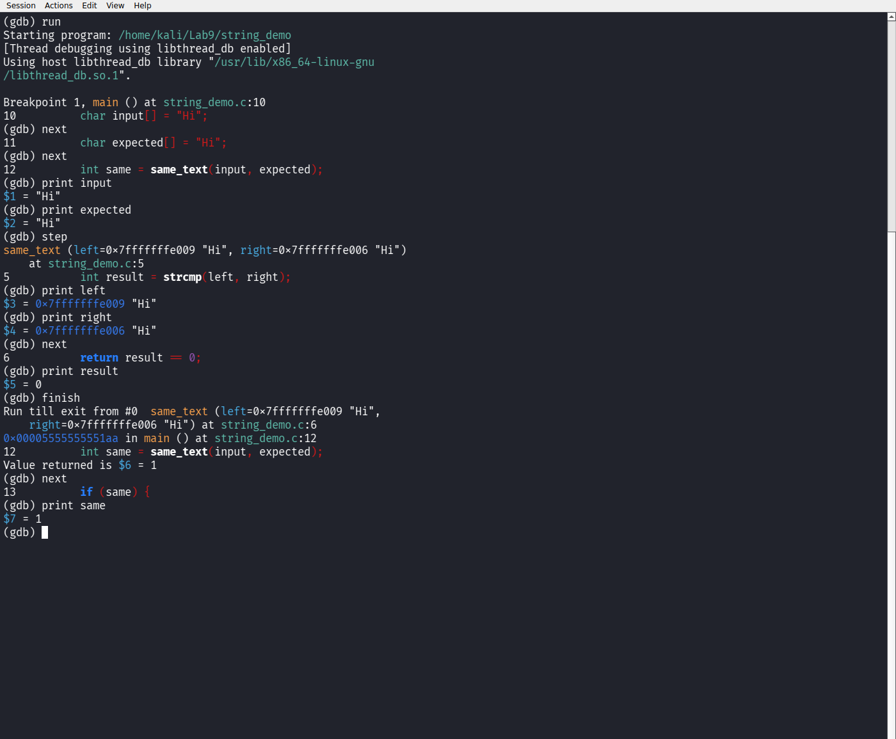
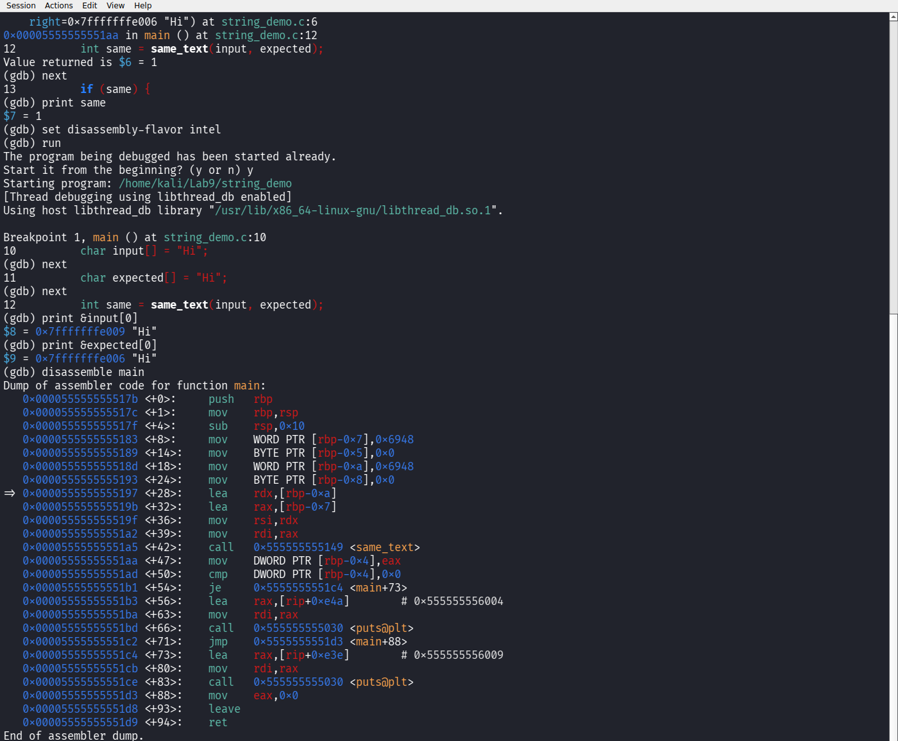
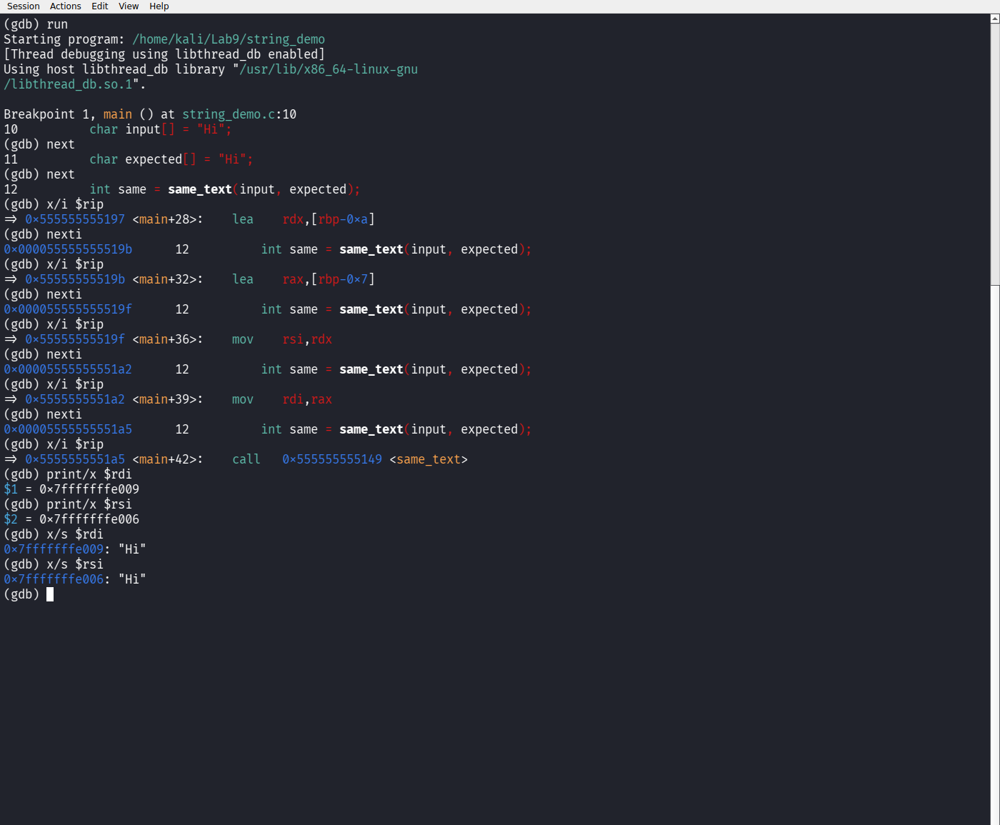
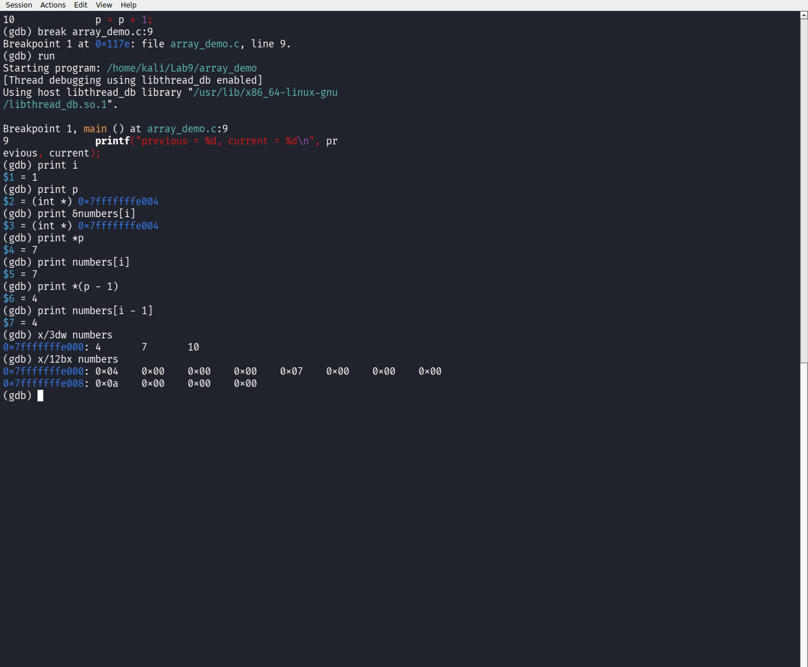

# Lab9：从 CLion 过渡到 GDB，观察函数调用、分支与数组

> **目标**：在 Linux/x86-64 的 Kali 中，用 GDB 调试 Lab8 的字符串程序，把 C 函数的参数、返回值和 `if` 分支对应到实际指令；用整数数组观察指针移动前后的地址与内容。最后阅读 `bomb.c`，说明一个输入文件如何依次供给多个阶段。

## 一、任务安排与提交内容

| 时间 | 课堂任务 | 观察结果 |
| :--- | :--- | :--- |
| 0～25 分钟 | 对照 CLion 完成一次 GDB 源码调试 | 读出字符串内容、结束符和比较结果 |
| 25～55 分钟 | 不退出 GDB，重新运行到函数调用前暂停，单步走过分支，再独立复做两串不同的情况 | 对照两次的参数、返回值、跳转和输出 |
| 55～78 分钟 | 在数组循环中连续两次命中同一断点，再到指令里找出取元素、移指针和循环跳转 | 核对相邻元素、地址差与元素大小，对照两次循环跳转的去向 |
| 78～90 分钟 | 阅读 `bomb.c` 的中文注释，沿 `main` 跟踪前两行输入 | 完成第六节的源码阅读记录 |

课前完成第二节的安装和编译。字符串程序沿用 Lab8 第 6.4 节，两个练习都在 Kali 的 `~/Lab9` 中运行。

材料目录：

```text
homework/Lab9/
├── Lab9.md
├── string_demo.c    字符串练习，沿用 Lab8 6.4
├── array_demo.c     数组与指针练习
└── bomb.c           中文注释版，只阅读，不编译
```

最终提交 **报告和四张截图，共 5 个文件**。四张截图分别为 GDB 源码调试、`main` 的反汇编、调用前的寄存器和数组循环暂停。不提交源码和可执行文件。提交清单与截止时间见第七节。

开始前，在课程仓库根目录下本人的 `学号姓名/` 中建立 `Lab9/imgs/`，把 `homework/Lab9/Lab9.md` 复制到 `学号姓名/Lab9/`，在这份副本上填写，截图保存到 `imgs/`。填写位置和截图引用都放在对应的操作处，课堂上做到哪里就填到哪里、截到哪里，地址取本人本次运行值。保留说明和示例，只替换标有“本人”的记录、粘贴框和第六节的阅读记录表。4.4 是选做，不需要填写。

截图用电脑的截图功能保存为 PNG，文件名全部小写，不使用手机拍屏。截 Kali 虚拟机窗口或远程连接的终端窗口都可以。每张图应同时显示 `(gdb)` 提示符后的命令和它的输出，文字清晰可读。建议命令一执行完就截图，后面的输出会把它顶出窗口；已经滚出窗口时，先拉高终端窗口或向上滚动，再截图。

> 本人姓名、10 位学号：张寅 2026010008

## 二、课前在 Kali 准备文件

### 2.1 准备工具与字符串程序

以下命令在 **Kali 终端**逐条输入，不包含提示符：

```bash
uname -s
uname -m
pwd
sudo apt update
sudo apt install -y gcc gdb
mkdir -p ~/Lab9
cd ~/Lab9
```

系统应为 `Linux`，架构应为 `x86_64`。`~` 是用户主目录，`mkdir -p` 创建目录，`cd` 切换目录，`pwd` 显示当前位置。后续实验使用固定目录，避免找错文件。编译和调试不使用 `sudo`。

若显示 `aarch64`，应由教师准备兼容的 x86-64 Linux 环境；不能将本手册的寄存器和指令直接套在 ARM 程序上。

> 本人系统与架构：`Linux` / `x86_64`

将 Lab8 6.4 已学习的 [string_demo.c](string_demo.c) 放入 Kali 的 `~/Lab9/`，确认 `input`、`expected` 均为 `"Hi"`。复制方式与 Lab8 第六步相同，只是文件换成 `string_demo.c`；编译时增加 `-g -O0` 以便调试。使用 Remote-SSH 时在远程文件夹中创建该文件并复制给定源码即可。也可以在 **Windows Git Bash 的课程仓库根目录**执行，替换用户名及 IP：

```bash
scp homework/Lab9/string_demo.c kali@虚拟机IP:~/Lab9/
```

回到 Kali 执行：

```bash
cd ~/Lab9
ls -l
cat string_demo.c
gcc -g -O0 -o string_demo string_demo.c
./string_demo
```

`gcc` 将源码生成可执行文件；`-g` 保留调试信息，`-O0` 便于按源码观察，`-o` 指定输出名，`./` 表示当前目录。预期输出为 `same`。修改源码后必须重新编译。

### 2.2 准备数组程序

将 [array_demo.c](array_demo.c) 放入同一目录。使用 Remote-SSH 可直接复制文件，使用 Windows Git Bash 时在仓库根目录执行：

```bash
scp homework/Lab9/array_demo.c kali@虚拟机IP:~/Lab9/
```

回到 Kali 编译并运行：

```bash
cd ~/Lab9
gcc -g -O0 -o array_demo array_demo.c
./array_demo
```

应先后看到 `previous = 4, current = 7` 和 `previous = 7, current = 10`。第五节将观察两次输出前的指针位置。

## 三、先调试熟悉的函数

### 3.1 先复习字符数组与字符串

先回顾 [Lab8 6.4](../Lab8/Lab8.md#64-课堂短练习字符数组字符串参数与比较结果) 中已经运行和调试过的程序：

- `input` 和 `expected` 各保存 `48 69 00`，末尾的 `00` 是字符串结束符。
- `same_text` 的 `left`、`right` 接收两个首字符地址，再交给 `strcmp` 比较内容。
- 两串相同时，`strcmp` 返回 0，`same_text` 返回 1；不同则分别为非零和 0。

课堂口头核对即可。尚未完成这段练习的同学应课前补做；下面保留两个 `"Hi"`，把熟悉的 CLion 操作对应到 GDB 命令。

### 3.2 区分三个输入位置

| 当前状态 | 输入内容 |
| :--- | :--- |
| Kali Shell 提示符 | `cd`、`gcc`、`gdb` 等终端命令 |
| `(gdb)` 提示符 | 断点、执行、查看内存等调试命令 |
| 程序正在等待输入，没有 `(gdb)` 提示符 | 程序要求的输入文字（Lab10 会用到） |

分清这三处，后面的命令才敲得对地方。CLion 里不存在这个问题：源码在编辑器、变量在 Variables、程序输入在 Console，各占一块，敲键盘的地方一眼能认出来。终端把这三件事挤在同一个光标后面，只能靠提示符区分。接下来在练习程序上走一遍。

### 3.3 在练习程序上逐条走完第一次调试

这一段要做的事，在 CLion 里基本都点过：下断点、启动调试、Step Over、Step Into、看变量。区别只是从点按钮换成敲命令。下面这张表把两边的操作对上号，敲到哪一条拿不准，回头看一行就够；每条命令的“作用”里也会再点出它对应 CLion 的哪个按钮或面板。

| CLion 操作 | GDB 命令 | 含义 |
| :--- | :--- | :--- |
| 下断点（行号左侧红点） | `break main` | 在函数入口停下，不必指定行号 |
| 启动调试（Shift+F9） | `run` | 带调试器运行，遇到断点停住 |
| Step Over（F8） | `next` | 执行当前源码语句，不进入调用内部 |
| Step Into（F7） | `step` | 进入有源码可调试的函数 |
| Step Out（Shift+F8） | `finish` | 执行完当前函数并返回调用者 |
| Resume（F9） | `continue` | 继续执行到下一个断点或结束 |
| 悬停变量 / Variables | `print 表达式` | 读取指定变量或表达式 |
| 展开数组或指针看字符串 | `x/s 地址或变量` | 把该地址处按字符串显示 |
| Stop（Ctrl+F2） | `quit` | 结束调试，退出调试器 |

第五节用 `continue` 让循环走到同一断点的下一次命中。`print` 与 `x/s` 分别在第 7 条和第 3.4 节出现。

在 Kali 终端切换到练习目录：

```bash
cd ~/Lab9
```

预期：没有任何输出，提示符回到下一行。

作用：把当前目录换成放有 `string_demo` 的目录；后面的 `./string_demo` 指当前目录下的文件，目录不对就找不到。

在 Kali 终端启动 GDB：

```bash
gdb -q ./string_demo
```

预期：先打印 `Reading symbols from ./string_demo...`，最后一行是 `(gdb)`。

作用：`-q` 省掉版权说明，`./string_demo` 是要调试的程序。从出现 `(gdb)` 开始，输入的每一行都按调试命令解释。

以下 16 条在 `(gdb)` 提示符下逐条输入。每条只敲一行，先对照“预期”，一致再敲下一条。地址与行号由编译器和 GDB 版本决定，你的可能不同；只要指令结构和显示的文字对得上就算正常。

**第 1 条：关闭分页**

```gdb
set pagination off
```

预期：没有输出，提示符仍是 `(gdb)`。

作用：关闭长输出的分页等待。不关的话，`disassemble`、`list` 这类较长的输出会停在 `--More--`，要再按一次回车才继续。

**第 2 条：在 `main` 入口下断点**

```gdb
break main
```

预期：`Breakpoint 1 at 0x1183: file string_demo.c, line 10.`

作用：在 `main` 函数体的第一条语句处设断点。对应 CLion 里在行号左侧点出红点（Ctrl+F8）；差别是 CLion 要点在具体某一行上，`break main` 直接按函数名把断点打在入口。`0x1183` 是编译器排下的地址，你的不同属正常；`Breakpoint 1` 的编号由 GDB 按设置顺序排。

**第 3 条：运行**

```gdb
run
```

预期：

```text
Starting program: /home/kali/Lab9/string_demo

Breakpoint 1, main () at string_demo.c:10
10	    char input[] = "Hi";
```

作用：从程序开头开始运行，遇到断点停下。对应 CLion 的 Debug 按钮（Shift+F9）。Run（Shift+F10）同样能把程序跑起来，但不会在断点处停住。停下时第 10 行还没有执行，`input` 里仍是未初始化的内容。

**第 4 条：查看源码**

```gdb
list
```

预期：打印 `string_demo.c` 中当前行上下共十行左右，行号约从 5 到 14，能看到 `same_text` 的定义和 `main` 的开头。

作用：确认当前停在源码的哪一行。对应 CLion 的编辑器窗口：那边停在哪一行，窗口里就有高亮，不用做任何事；GDB 没有编辑窗口，只能把源码打印到终端。`list` 只显示源码，不显示机器指令。

**第 5 条：执行 `input` 的初始化**

```gdb
next
```

预期：`11	    char expected[] = "Hi";`

作用：执行完当前这一行（把 `"Hi"` 和结束符写进 `input`），停在下一行。对应 CLion 的 Step Over（F8）：执行一行，不钻进函数内部。GDB 会把即将执行的那行源码打印出来，这就是“停在哪里”的证据。

**第 6 条：执行 `expected` 的初始化**

```gdb
next
```

预期：`12	    int same = same_text(input, expected);`

作用：又一次 Step Over（F8），执行 `expected` 的初始化。到这里两个数组都有内容了，但 `same_text` 还没被调用。若你的行号整体差一两行，以屏幕上出现 `int same = same_text(...)` 为准，不必和本文完全一致。

**第 7 条：查看第一个数组**

```gdb
print input
```

预期：`$1 = "Hi"`

作用：按变量本身的类型打印。对应 CLion 里把鼠标停在变量上，或看 Variables 面板里的那一行。`input` 是 `char` 数组，GDB 把它当字符串显示到结束符为止，所以看到的是文字而不是地址。

**第 8 条：查看第二个数组**

```gdb
print expected
```

预期：`$2 = "Hi"`

作用：同上看 Variables 面板，只是从“面板里扫一眼”换成“点名要一个”。`$1`、`$2` 是 GDB 给历史值编的号，每打印一次加一，不必关心具体数字。

**第 9 条：进入被调用的函数**

```gdb
step
```

预期：

```text
same_text (left=0x7fffffffe0a9 "Hi", right=0x7fffffffe0a6 "Hi") at string_demo.c:5
5	    int result = strcmp(left, right);
```

作用：进入 `same_text` 内部，停在它的第一条语句。对应 CLion 的 Step Into（F7）：同样是钻进被调用的函数。第一行括号里的 `left=…`、`right=…` 是 GDB 顺带显示的实参，等于 CLion 在 Frames 里选到 `same_text` 那一帧后看到的参数。

**第 10 条：查看第一个参数**

```gdb
print left
```

预期：`$3 = 0x7fffffffe0a9 "Hi"`

作用：`left` 是指针，GDB 同时打印它保存的地址和该地址上的字符串。CLion 里这两样分散在两处：地址看 Variables 里的指针值，字符串要把指针展开。

**第 11 条：查看第二个参数**

```gdb
print right
```

预期：`$4 = 0x7fffffffe0a6 "Hi"`

作用：同上。这两个地址分别与 `main` 里 `input`、`expected` 的首字符地址相同；参数传的是地址，不是内容。CLion 的 Frames 面板里也能看到 `left`、`right` 两个参数，GDB 这里是一个一个问。

**第 12 条：执行比较**

```gdb
next
```

预期：`6	    return result == 0;`

作用：Step Over（F8），执行 `int result = strcmp(left, right);`。此时 `strcmp` 已经算完，结果存进了 `result`。

**第 13 条：查看比较结果**

```gdb
print result
```

预期：`$5 = 0`

作用：两串相同时 `strcmp` 返回 0。这一步读到的是 `strcmp` 的返回值；`same_text` 自己的返回值还没产生。在 CLion 里就是 Variables 面板中 `result` 后面那个 `0`。

**第 14 条：执行完函数并返回**

```gdb
finish
```

预期：

```text
Run till exit from #0  same_text (left=0x7fffffffe0a9 "Hi", right=0x7fffffffe0a6 "Hi")
    at string_demo.c:6
0x00005555555551aa in main () at string_demo.c:12
12	    int same = same_text(input, expected);
Value returned is $6 = 1
```

作用：把 `same_text` 剩下的语句执行完并回到 `main`，同时打印它的返回值。对应 CLion 的 Step Out（Shift+F8）：一口气跑完当前函数，回到调用它的地方。返回 1 是因为 `return result == 0;` 中 `0 == 0` 为真。

**第 15 条：把返回值存进 `same`**

```gdb
next
```

预期：`13	    if (same) {`

作用：Step Over（F8），执行整条赋值语句，返回值写进 `same`。`finish` 停在第 12 行中间（函数已返回、赋值还没做），所以必须先执行这一步才能读到 `same`。

**第 16 条：查看 `same`**

```gdb
print same
```

预期：`$7 = 1`

作用：确认赋值完成。1 表示两串相同，程序接下来会执行 `printf("same\n")` 这一支。走到这里，CLion 和 GDB 看到的信息完全一样，区别只在获取方式：一个是面板，一个是命令。

本人 GDB 调试截图：保存 `imgs/lab9_gdb.png`。图中应能辨认第 9～16 条的命令和输出，即 `step` 进入 `same_text` 时显示的两个参数、`finish` 打印的返回值和 `print same` 的结果。



先不要退出 GDB：执行完 `print same` 后仍停在 `main` 中，两个数组已经初始化。下一节直接在这个暂停状态读取内存字节。

### 3.4 把文字与内存字节对应起来

接着上一节的暂停状态执行，两个数组已经初始化。如果已经退出 GDB，按 3.3 的做法重新进入调试，再用那 16 条中的第 1～6 条回到停在 `int same = ...` 的位置。

**第 1 条：按字符串读取**

```gdb
x/s input
```

预期：`0x7fffffffe0a9:	"Hi"`

作用：`x` 表示查看内存，`s` 表示按字符串显示，即从这个地址开始读，读到结束符为止。对应 CLion 里把 `input` 在 Variables 面板展开：同样是读地址上的内容并按文字显示，只是格式由 CLion 替你选好，GDB 要自己用 `s` 指定。

**第 2 条：按字节读取**

```gdb
x/3bx input
```

预期：`0x7fffffffe0a9:	0x48	0x69	0x00`

作用：`3` 是读三个单元，`b` 是每个单元一字节，`x` 用十六进制显示。`0x48`、`0x69` 正是 `H`、`i` 的编码，`0x00` 是结束符。CLion 的 Variables 面板默认按字符显示数组，看不到这串十六进制；要看原始字节，就得像这样把格式写清楚。

同一条 `x` 命令只换一个格式字母，输出就完全不同：`s` 看到文字，`b` 看到字节。GDB 把每个字节显示成带 `0x` 的形式；本文正文有时简写成 `48`，指的是同一个字节。

仍然不要退出 GDB。下一节在同一个会话里把程序从头再跑一遍，观察调用前的机器指令，不需要修改源码或重新编译。

## 四、在汇编中观察函数调用与条件分支

### 4.1 认识最少的寄存器

寄存器是 CPU 中保存当前数据的位置，可以保存整数，也可以保存地址。在本实验的 Linux/x86-64 函数调用中，先只观察：

| 名称 | 本次用途 |
| :--- | :--- |
| `rdi` | 第一个普通整数或指针参数的位置 |
| `rsi` | 第二个普通整数或指针参数的位置 |
| `eax` | 普通整数返回值的位置 |
| `rip` | 当前即将执行的指令地址 |
| `rsp` | 栈顶地址；函数的局部变量和数组就放在栈上（第五节用到） |

`eax` 和 `rax` 是同一个寄存器的两个名字：`rax` 指完整的 64 位，`eax` 指其中的低 32 位。`int` 占 4 字节，所以整数返回值写作 `eax`；地址占 8 字节，要用 `rax` 这样的 64 位名字。`rdi` 与 `edi`、`rsi` 与 `esi` 同理。向 32 位名字写入数值时，高 32 位会被清零，所以一条写 `esi` 的指令执行完，整个 `rsi` 的值也就确定了。

GDB 表达式中加 `$`，例如 `$rdi`。`print/x $rdi` 显示该寄存器保存的数值；`x/s $rdi` 把这个数值作为地址，读取那里的文字。参数位置必须在合适时刻观察，调用完成后寄存器可能已被改写。

CLion 的调试窗口里有寄存器视图（界面默认不一定显示，需要时在调试窗口里打开），这些值成排摆着，点开就看；GDB 没有常驻面板，要看哪个就用 `print` 点名，所以得先把这几个名字记住。

### 4.2 先在有源码的程序中观察一次调用

Lab8 已用 Step Into、Step Out 观察 `add` 和 `same_text`，刚才又用 GDB 查看了 `left`、`right` 和 `result`。现在仍然观察“传入什么、返回什么”，只是增加机器指令和寄存器这两个观察位置。

接着 3.4 的会话继续，不用退出 GDB：`break main` 的断点和 `set pagination off` 的设置都还有效。程序此刻已经执行过 `same_text`，要看调用之前的状态，就让它从头再跑一遍。

如果已经退出了 GDB，在 Kali 终端执行 `cd ~/Lab9` 和 `gdb -q ./string_demo` 重新进入，先补敲 `set pagination off` 和 `break main`，再从下面第 1 条开始；这种情况下第 2 条的 `run` 不会提问，直接运行到断点。

以下 16 条按顺序执行，每条一行。

**第 1 条：改用 Intel 写法**

```gdb
set disassembly-flavor intel
```

预期：没有输出。

作用：让反汇编按 Intel 写法显示，目标操作数在左、源操作数在右。GDB 默认是 AT&T 写法，寄存器名带 `%`、两个操作数顺序相反；不先设这一条，后面读指令很容易把“谁送给谁”看反。

**第 2 条：从头重新运行**

```gdb
run
```

预期：GDB 先问一句，输入 `y` 并回车后程序重新开始：

```text
The program being debugged has been started already.
Start it from the beginning? (y or n) y
Starting program: /home/kali/Lab9/string_demo

Breakpoint 1, main () at string_demo.c:10
10	    char input[] = "Hi";
```

作用：程序还停在上一轮的位置，GDB 先确认是否放弃它。回答 `y` 后这一轮运行被结束，程序从头开始，再次停在 `main` 的断点，两个数组又回到未初始化的状态。对应 CLion 的 Rerun（Ctrl+F5）：不关调试窗口，直接重来一遍。断点设在 GDB 里，不属于某一次运行，所以不用重设。

**第 3 条：执行 `input` 的初始化**

```gdb
next
```

预期：`11	    char expected[] = "Hi";`

作用：Step Over（F8），执行当前行，停在下一行。

**第 4 条：执行 `expected` 的初始化**

```gdb
next
```

预期：`12	    int same = same_text(input, expected);`

作用：再按一次 Step Over（F8），执行第二个数组的初始化。此时停在这条调用语句的开头，调用还没有发生，正好可以看它之前要准备什么。

**第 5 条：打印第一个数组的地址**

```gdb
print &input[0]
```

预期：`$8 = 0x7fffffffe0a9 "Hi"`

作用：`&` 取地址。这一步要的是地址而不是内容，用来和后面寄存器里的值对照。CLion 里普通数组的地址默认不显示，得在 Evaluate Expression（Alt+F8）里输入 `&input[0]` 才看得到；GDB 直接问就行。`$` 后的编号接着 3.3 往下排，你的数字不同也没关系。

**第 6 条：打印第二个数组的地址**

```gdb
print &expected[0]
```

预期：`$9 = 0x7fffffffe0a6 "Hi"`

作用：同上，得到第二参数的地址。CLion 里同样要在 Evaluate Expression 里问 `&expected[0]`。示例中两个地址只差 3：两个数组各占 3 字节，在栈上紧挨着。这两个地址上的内容，3.4 刚用 `x/s` 和 `x/3bx` 看过，这里不再重复。

**第 7 条：查看 `main` 的机器指令**

```gdb
disassemble main
```

预期：以 `Dump of assembler code for function main:` 开头，逐条列出 `main` 的指令，最后一行 `End of assembler dump.`。其中有一段形如：

```text
   0x00005555555551a5 <+42>:	call   0x555555555149 <same_text>
   0x00005555555551aa <+47>:	mov    DWORD PTR [rbp-0x4],eax
```

程序运行起来之后，指令地址都以 `0x5555` 开头。3.3 中 `break main` 在运行前显示的 `0x1183` 是指令在可执行文件里的位置；程序装入内存时整体加上一个基址，末尾的 `183` 不变。

本人反汇编截图：保存 `imgs/lab9_disas.png`。图中应能辨认 `disassemble main` 这条命令、输出开头的 `Dump of assembler code for function main:`，以及目标为 `same_text` 的那一行 `call`。指令应为 Intel 写法，寄存器名前没有 `%`。



作用：把 `main` 的机器指令显示为汇编。CLion 的 Debug 窗口也能切到反汇编视图（Show Disassembly），列出来的是同一批指令。`call ... <same_text>` 就是源码中 `same_text(input, expected)` 那一条；它上面的几条 `mov`、`lea` 在准备两个参数，下面的 `mov` 把返回值存回 `same`。地址、偏移和中间的指令条数随编译结果不同，只要找到 `call ... <same_text>` 这一行即可。

**第 8 条：看当前即将执行的指令**

```gdb
x/i $rip
```

预期：一行以 `=>` 开头，例如 `=> 0x555555555197 <main+28>:	lea    rdx,[rbp-0xa]`。

作用：`$rip` 保存下一条要执行的指令的地址，`x/i` 把它反汇编成一条指令。`=>` 标出的就是这条指令，相当于 CLion 里那个指向“下一条要执行的源码行”的黄色箭头，只是细到一条机器指令。此时它通常还在准备参数，不是 `call`。

**第 9 条：前进一条机器指令（重复执行）**

```gdb
nexti
```

预期：打印一行新的地址和当前源码行，例如 `0x000055555555519b	12	    int same = same_text(input, expected);`，地址比上一条大。每次执行后再用 `x/i $rip` 看一次，`=>` 已移到紧随其后的一条；重复到出现 `call   0x555555555149 <same_text>` 这样的一行为止。

作用：执行一条机器指令。CLion 的 Step Over 以源码行为单位，界面上没有对等的按钮，可以把它当成更细一档的 Step Over：一步只走一条指令。这里没有逐行的源码对应关系，只能一条条走，看到 `call` 就停。重复次数由你的编译结果决定，不要求和别人一致。

第 8 条与第 9 条交替执行，直到当前指令显示为目标为 `same_text` 的 `call`。**这是全班同步检查点：看到 `call` 后先停住，等教师确认，不要先执行它。** 已经到达的同学也先等待，和周围同学一起核对暂停位置。不要求理解此前每条指令，也不要照抄其他同学的地址。

| 当前 `x/i $rip` 显示 | 下一步 |
| :--- | :--- |
| 不是 `call ... <same_text>` | `nexti` 一次，再用 `x/i $rip` 查看 |
| `call ... <same_text>` | 停住，接着做第 10、11 条 |

**第 10 条：读取第一个参数**

```gdb
print/x $rdi
```

预期：`$10 = 0x7fffffffe0a9`

作用：以十六进制打印 `rdi`。它是第一个参数的位置，数值应当等于第 5 条打印的 `&input[0]`。CLion 的寄存器视图里能看到同一个 `rdi`，这里用 `print` 点名取。

**第 11 条：读取第二个参数**

```gdb
print/x $rsi
```

预期：`$11 = 0x7fffffffe0a6`

作用：第二个参数的位置，数值应当等于第 6 条打印的 `&expected[0]`。同上，在 CLion 里对应寄存器视图中的 `rsi`。

**第 12 条：按字符串读第一个参数**

```gdb
x/s $rdi
```

预期：`0x7fffffffe0a9:	"Hi"`

作用：把寄存器里的数值当地址，读出那里的文字。读法与 3.4 第 1 条相同，只是地址这次来自寄存器；CLion 里是把指针参数展开。能读出 `Hi`，才说明这个参数确实指向第一个字符串。

**第 13 条：按字符串读第二个参数**

```gdb
x/s $rsi
```

预期：`0x7fffffffe0a6:	"Hi"`

作用：同上，核对第二个参数，在 CLion 里就是把 `rsi` 指向的字符串展开看。

此时读到的才是本次调用准备的参数。若已经执行了 `call`，`rdi`、`rsi` 可能已被 `same_text` 内部改写，不能再用它们证明调用参数；应重新 `run` 到 `call` 前。

本人寄存器截图：先保存 `imgs/lab9_regs.png`，再执行第 14 条。图中应能辨认 `x/i $rip` 显示的 `call ... <same_text>`，以及第 10～13 条的命令和输出，即 `rdi`、`rsi` 的数值和它们指向的文字。这四条命令必须在 `call` 之前执行；如果已经越过 `call` 才想起来读，截到的就不是调用参数，要重新 `run` 到这里再截。



把截图中 `rdi`、`rsi` 的数值与第 5、6 条读到的两个数组地址比较，说明每个参数指向哪个数组。

> 本人说明：两个数组的地址为 `&input[0]` = `0x7fffffffe009`、`&expected[0]` = `0x7fffffffe006`，两者相差 3 字节，正好各是 `"Hi"` 的 3 个字节。`rdi` = `0x7fffffffe009`，与 `&input[0]` 相同，说明第一个参数指向 `input`；`rsi` = `0x7fffffffe006`，与 `&expected[0]` 相同，说明第二个参数指向 `expected`。用 `x/s $rdi`、`x/s $rsi` 也分别读出了 `"Hi"`、`"Hi"`，可以互相印证。

**第 14 条：执行这次调用**

```gdb
nexti
```

预期：`0x00005555555551aa	12	    int same = same_text(input, expected);`

作用：在 `call` 上执行一条机器指令，等于把整个 `same_text` 跑完再回来，停在它的下一条。这就是 CLion 里 Step Over 掉一次调用的效果。

**第 15 条：读返回值**

```gdb
print $eax
```

预期：`$12 = 1`

作用：普通整数返回值放在 `eax`。1 说明 `same_text` 判定两串相同。CLion 里这个数要在 Step Out 之后才看得到：界面上给的是返回值那一项，或者去调试控制台里问。注意它内部 `strcmp` 的返回值是 0，两者不是同一个数，`eax` 里的是 `same_text` 自己算出来的。

**第 16 条：确认已经越过调用**

```gdb
x/i $rip
```

预期：`=> 0x5555555551aa <main+47>:	mov    DWORD PTR [rbp-0x4],eax`

作用：`=>` 指向的已经是 `call` 之后的指令，说明调用确实执行完了；这个地址与 3.3 第 14 条 `finish` 之后显示的返回位置相同。下一条指令把 `eax` 写进 `same`。在 CLion 里，这时黄色箭头也往下挪了一行。

### 4.3 从返回值走到 `if (same)`

先把刚才读到的 `eax` 填入本节末尾记录表的第一行。此刻程序停在 `call` 的下一条指令，仍在 `main` 中。执行：

```gdb
disassemble /s main
x/i $rip
```

在混合显示的源码和指令中找到 `if (same)`、两个输出语句，以及判断后紧接着的条件跳转。常见写法是 `cmp ..., 0` 或 `test eax,eax` 检查零值，再由 `je`（为零时跳转）或 `jne`（非零时跳转）选择路径。编译器可能调整分支顺序，以本人的指令和目标地址为准。

1. 先据 `eax` 预测会打印哪个词。在 GDB 中交替执行 `x/i $rip` 和 `nexti`，直到当前指令是刚找到的条件跳转。把该指令及其目标地址抄进记录表。
2. 执行一次 `nexti`，再用 `x/i $rip` 查看实际到达的位置，填入记录表。若等于跳转目标，就发生了跳转；否则沿顺序执行。用 `list *$rip` 对照附近源码。
3. 执行 `continue`，将程序实际打印的词填入记录表，随后 `quit` 回到 Shell。`quit` 对应 CLion 的 Stop（Ctrl+F2）。此时程序已经结束，GDB 直接退出；如果程序还停在断点上，它会先问 `Quit anyway? (y or n)`，输入 `y` 并回车即可。

接下来独立复做：只把 Kali 练习副本中 `char expected[] = "Hi";` 的 `Hi` 改为 `Ho`，保留 `input` 为 `Hi`。用第二节的命令重新编译 `string_demo`，再用 `gdb -q ./string_demo` 启动一个新会话。新会话里没有上一轮的设置，先敲 `set pagination off` 和 `break main`，再做 4.2 的 16 条（这次第 2 条的 `run` 不会提问），从调用前检查点走到分支，把这一轮的结果填入下表第二行。

本人两轮记录，地址和指令取本人本次运行值：

| 传给函数的两个字符串 | 调用后的 eax | 实际条件跳转指令（含目标地址） | 执行跳转指令后的 rip | 预测输出 / 实际输出 |
| :--- | :--- | :--- | :--- | :--- |
| Hi 与 Hi | `1` | `je 0x5555555551c4 <main+73>`（前一条为 `cmp DWORD PTR [rbp-0x4],0x0`） | `0x5555555551b3` | 预测 `same` / 实际 `same` |
| Hi 与 Ho | `0` | `je 0x5555555551c4 <main+73>` | `0x5555555551c4` | 预测 `different` / 实际 `different` |

两串相同时，`strcmp` 和 `same_text` 分别返回什么？结合你记录的跳转指令，说明哪一轮发生了跳转。

> 本人回答：两串相同时，`strcmp` 返回 0（3.3 第 13 条 `print result` 读到的是 `0`），`same_text` 返回 1（`return result == 0;` 中 `0 == 0` 为真，3.3 第 14 条 `finish` 打印 `Value returned is ... = 1`）。`Hi` 与 `Ho` 那一轮，两个字符串第一个不同的字符是 `i` 和 `o`，`strcmp` 返回非零，`same_text` 因此返回 0。`if (same)` 在汇编里是先把 `same` 与 0 比较，再按“结果为零就跳转”安排分支（`je` 一类指令，跳到打印 `different` 的那一支），所以 `same == 0` 的 `Hi`/`Ho` 这一轮发生了跳转，跳转目标落在 `different` 分支；`Hi`/`Hi` 这一轮 `same` 为 1，条件不成立，顺序执行打印 `same` 的那几条指令。实际以本人反汇编中那条条件跳转的目标地址所在分支为准。

### 4.4 选做：去掉调试信息后还剩什么

这一小节不计入报告，课堂有余力或课后再做。前面的程序都带 `-g` 编译，GDB 才能显示源码行和变量名。Lab10 的 `bomb` 中，各阶段的函数只留下函数名，没有源码行，也没有变量名。先用熟悉的程序看看这种情况下哪些命令还能用。

在 Kali 终端把同一份源码不带 `-g` 再编译一份，并启动 GDB：

```bash
cd ~/Lab9
gcc -O0 -o string_nodebug string_demo.c
gdb -q ./string_nodebug
```

预期：`Reading symbols from ./string_nodebug...` 之后多出一行 `(No debugging symbols found in ./string_nodebug)`。

在 `(gdb)` 提示符下逐条输入：

```gdb
break same_text
run
list
print left
x/s $rdi
x/s $rsi
finish
print $eax
quit
```

| 命令 | 现在的结果 | 原因 |
| :--- | :--- | :--- |
| `break same_text` | `Breakpoint 1 at 0x...`，后面不再有文件名和行号 | 函数名还在可执行文件里，仍能按名字下断点 |
| `run` | `Breakpoint 1, 0x... in same_text ()`，括号里没有参数 | GDB 不再知道参数叫什么、是什么类型 |
| `list`、`print left` | 报错，例如 `No symbol table is loaded.  Use the "file" command.` | 源码行和变量名都来自 `-g` 写入的调试信息 |
| `x/s $rdi`、`x/s $rsi` | 照常读出两个字符串 | 寄存器和内存属于正在运行的程序，与调试信息无关 |
| `finish` | 回到 `main ()`，不再打印 `Value returned` | GDB 不知道返回值的类型 |
| `print $eax` | 读出 `same_text` 的返回值 | 返回值仍在约定的寄存器里 |

`quit` 询问时输入 `y`。能用的只剩函数名、指令、寄存器和内存，这正是 4.2 练过的读法，Lab10 会一直用它。

## 五、从整数指针到相邻数组元素

程序中的核心代码为：

```c
int numbers[3] = {4, 7, 10};
int *p = &numbers[1];
```

`p` 指向第二个整数。`*p` 是第二项，`*(p - 1)` 是前一项。C 中 `int *` 前进 1 表示前进一个 `int`，本实验环境中是 4 字节。

Lab8 已经用 `student_id[i]` 按下标读取元素，也用 `*p` 读取指针所指的整数。本次把这两种访问方式放到同一组数组上核对，再到机器指令里找出它们各自的写法。

### 5.1 用变量名核对指针与下标

在 Kali Shell 启动 GDB：

```bash
cd ~/Lab9
gdb -q ./array_demo
```

这是一个新会话，开头两条设置要重新敲。随后执行 `list main` 查看实际行号，在 `printf` 所在行设置断点。将下面的 `行号` 替换为数字：

```gdb
set pagination off
set disassembly-flavor intel
list main
break array_demo.c:行号
run
print i
print p
print &numbers[i]
print *p
print numbers[i]
print *(p - 1)
print numbers[i - 1]
x/3dw numbers
x/12bx numbers
```

先在同一次暂停中核对下面三组表达式，再预测第二次暂停时哪些值会变：

| 指针写法 | 下标写法 | 第一次暂停时的含义 |
| :--- | :--- | :--- |
| `p` | `&numbers[i]` | 都是第二个元素的地址 |
| `*p` | `numbers[i]` | 都读取第二个元素，值为 7 |
| `*(p - 1)` | `numbers[i - 1]` | 都读取前一个元素，值为 4 |

本人数组暂停截图：执行完上面这组命令后，在第一次暂停时保存 `imgs/lab9_array.png`。图中应能辨认断点命中的那一行、`print p` 与 `print &numbers[i]` 的结果，以及 `x/3dw numbers` 和 `x/12bx numbers` 的输出。



再把第一次暂停读到的地址与相邻值填在这里，供 5.3 对照：

| 本人第一次暂停 | p 的地址 | 前一个元素 *(p - 1) | 当前元素 *p |
| :--- | :--- | :--- | :--- |
| i = 1 | `0x7fffffffe004` | `4` | `7` |

第一次暂停时，`*p` 和 `*(p - 1)` 分别对应哪个下标？

> 本人回答：`i = 1` 时 `p` 等于 `&numbers[1]`，所以 `*p` 对应 `numbers[1]`（下标 1，值为 7）；`*(p - 1)` 比 `p` 少一个元素，对应 `numbers[0]`（下标 0，值为 4）。这两个写成下标就是 `numbers[i]` 和 `numbers[i - 1]`。

先不要 `continue`，在这个暂停点接着做 5.2。

### 5.2 在指令里找到取元素、移指针和循环跳转

刚才用 `p`、`*(p - 1)` 这些 C 写法读到的内容，现在到机器指令里找对应。Lab10 的程序没有这些变量名可用，只能读这一层。

```gdb
disassemble /s main
```

输出和 4.3 一样，源码与指令交替排列。只找下面四处，其余指令不要求读懂。示例取自 x86-64 Linux 上 `gcc -g -O0` 的一次编译，地址和偏移以本人输出为准：

```text
5	    int *p = &numbers[1];
   0x0000555555555156 <+29>:	lea    rax,[rbp-0x20]
   0x000055555555515a <+33>:	add    rax,0x4
   0x000055555555515e <+37>:	mov    QWORD PTR [rbp-0x8],rax

7	        int previous = *(p - 1);
   0x000055555555516b <+50>:	mov    rax,QWORD PTR [rbp-0x8]
   0x000055555555516f <+54>:	mov    eax,DWORD PTR [rax-0x4]
   0x0000555555555172 <+57>:	mov    DWORD PTR [rbp-0x10],eax

10	        p = p + 1;
   0x000055555555519a <+97>:	add    QWORD PTR [rbp-0x8],0x4

6	    for (int i = 1; i < 3; i = i + 1) {
   0x000055555555519f <+102>:	add    DWORD PTR [rbp-0xc],0x1
   0x00005555555551a3 <+106>:	cmp    DWORD PTR [rbp-0xc],0x2
   0x00005555555551a7 <+110>:	jle    0x55555555516b <main+50>
```

方括号表示“到这个地址取内容”，`DWORD PTR` 取 4 字节，`QWORD PTR` 取 8 字节。用 `-O0` 编译时，每个局部变量在栈上都有固定位置，本程序用 `rbp` 减一个偏移来表示。示例中 `[rbp-0x8]` 是 `p`，`[rbp-0xc]` 是 `i`，数组从 `[rbp-0x20]` 开始。

| C 源码 | 对应指令 | 读法 |
| :--- | :--- | :--- |
| `*(p - 1)` | `mov rax,QWORD PTR [rbp-0x8]`，接着 `mov eax,DWORD PTR [rax-0x4]` | 第一条把 `p` 保存的地址取到 `rax`。第二条到“这个地址减 4”的位置取 4 字节，放进 `eax`。C 写的是减 1 个元素，指令写的是减 4 字节。 |
| `&numbers[1]` | `lea rax,[rbp-0x20]`，接着 `add rax,0x4` | `lea` 只计算方括号里的地址，不去取内容；`mov` 才取内容。这里先算出数组首地址，再加 4 得到第二项的地址。 |
| `p = p + 1` | `add QWORD PTR [rbp-0x8],0x4` | 把保存 `p` 的那 8 字节加 4。 |
| `i < 3` | `cmp DWORD PTR [rbp-0xc],0x2`，接着 `jle ... <main+50>` | `cmp A,B` 比较两个数，结果只供后面的跳转使用，不改写 A 和 B。`jle` 在 A 小于或等于 B 时跳转；编译器把 `i < 3` 写成了 `i <= 2`。 |

4.3 的 `if` 向后跳过一段代码，这里 `jle` 的目标地址比它自己的地址小。程序跳回循环体开头重新执行，循环在指令中就是这样一条向回的条件跳转。

从本人的反汇编输出中抄下两条指令：读取 `*(p - 1)` 的那条带 `-0x4` 的指令，以及 `p = p + 1` 对应的指令。

```text
   0x000055555555516f <+54>:	mov    eax,DWORD PTR [rax-0x4]
   0x000055555555519a <+97>:	add    QWORD PTR [rbp-0x8],0x4
```

先用寄存器核对刚才的读法，把 `0x8` 换成你反汇编中 `p = p + 1` 那条指令方括号里的偏移：

```gdb
print &numbers[0]
print/x $rsp
x/3dw $rsp
x/1gx $rbp-0x8
```

前两条应显示同一个地址：本程序的数组正好放在栈顶，所以 `x/3dw $rsp` 与 5.1 的 `x/3dw numbers` 输出相同。若两个地址不同，说明你的编译结果在栈顶另放了内容，不影响后面的步骤。`x/1gx` 中的 `g` 表示一个单元取 8 字节，读到的数值应等于 `print p` 显示的地址，这就证实 `[rbp-0x8]` 存放的是 `p`。

再看这几条指令实际执行。逐条输入：

```gdb
next
x/i $rip
print p
nexti
print p
```

`next` 执行 `printf` 这一行，屏幕上出现 `previous = 4, current = 7`，随后停在 `p = p + 1;`。此时 `x/i $rip` 显示的正是那条 `add ...,0x4`。`nexti` 执行它，前后两次 `print p` 应相差 4。

接着交替执行 `x/i $rip` 和 `nexti`，直到当前指令是 `jle`，一般再走两条就到。抄下这条指令及其目标地址，然后：

```gdb
nexti
x/i $rip
```

此时 `i` 已经加到 2，满足小于或等于 2，`rip` 应等于跳转目标，回到 `*(p - 1)` 的第一条指令。把实际结果填在这里：

| 本人第一轮循环跳转 | 条件跳转指令（含目标地址） | 执行跳转指令后的 rip | 是否跳回循环体 |
| :--- | :--- | :--- | :--- |
| 第一次暂停之后（比较时 i 为 2） | `jle 0x55555555516b <main+50>` | `0x55555555516b` | 是，跳回循环体开头的 `*(p - 1)` |

### 5.3 第二次暂停与循环结束

执行下面这组命令，程序会在第二次循环的同一行暂停：

```gdb
continue
print i
print p
print *(p - 1)
print *p
```

把第二次暂停读到的值填在这里：

| 本人第二次暂停 | p 的地址 | 前一个元素 *(p - 1) | 当前元素 *p |
| :--- | :--- | :--- | :--- |
| i = 2 | `0x7fffffffe008` | `7` | `10` |

对照 5.1 的记录，两次的 `p` 相差多少字节？怎样对应源码中的 `p = p + 1`？

> 本人回答：两次的 `p` 相差 4 字节（第一次指向 `numbers[1]`，第二次指向 `numbers[2]`）。`int` 占 4 字节，C 的 `p + 1` 表示前进一个 `int` 类型的元素，所以地址数值只加 4；在指令里就是一条 `add QWORD PTR [rbp-0x8],0x4`，把保存 `p` 的那 8 个字节加 4。

第一次 `i = 1`，`p` 指向第二项；第二次 `i = 2`，`p` 指向第三项，地址增加 4。这里 `p = p + 1` 改变的是指针保存的地址，Lab8 的 `*p = 26` 改变的则是所指位置的整数。`x/3dw` 表示按三个 4 字节单位显示十进制整数，`x/12bx` 将相同的 12 字节逐字节显示为十六进制。

接着把 5.2 末尾的单步再做一遍：`next` 一次，然后交替执行 `x/i $rip` 和 `nexti` 走到 `jle`，执行它，再用 `x/i $rip` 和 `list *$rip` 查看到达的位置。先预测：这一轮 `i` 加到 3，还会跳回去吗？把实际结果填在这里：

| 本人第二轮循环跳转 | 条件跳转指令（含目标地址） | 执行跳转指令后的 rip | 是否跳回循环体 |
| :--- | :--- | :--- | :--- |
| 第二次暂停之后（比较时 i 为 3） | `jle 0x55555555516b <main+50>` | `0x5555555551a9` | 否，顺序执行到 `return 0;`，退出循环 |

两轮的跳转结果为什么不同？这条跳转与 4.3 的 `if` 跳转相比，目标地址的方向有什么区别？

> 本人回答：`i` 加到 2 时，比较 `2 <= 2` 成立，`jle` 条件满足，跳回循环体开头继续执行；`i` 加到 3 时，比较 `3 <= 2` 不成立，`jle` 不跳转，程序顺着往下执行、退出循环，所以两轮结果不同。方向上的区别：这里的 `jle` 目标地址比它自身的地址小，是向后跳，跳回已经执行过的循环体开头；4.3 的 `if` 跳转目标地址比它自身大，是向前跳过一段代码，两段代码只会执行其中一支。

最后用 `continue` 让程序执行到结束，再用 `quit` 回到 Shell。

最后一次 `p = p + 1` 会得到数组末尾后一位置，但循环已结束，不再解引用它。形成该位置的指针与读取该位置的内容是不同操作。

本次新增的关键区别：**C 的 `p + 1` 按元素大小移动；汇编中寄存器数值加 4，表示地址数值直接增加 4 字节。** 5.2 中的 `[rax-0x4]` 和 `add ...,0x4` 就是 `p - 1` 与 `p + 1` 在指令中的写法。不要把这两种写法的数字机械对应。

## 六、最后一项任务：读懂 bomb.c 的主流程

直接打开本目录的 [bomb.c（中文注释版）](bomb.c)，从 `main` 开始阅读。这次只读源码，无需编译。假设输入文件的第一行是甲，第二行是乙，两行都能通过各自的检查。顺着下面三个问题在代码里找依据。

1. **输入从哪里来？** 对照 `./bomb` 和 `./bomb answers.txt`。程序名本身计入 `argc`；分别找出对应的 `if` 或 `else if`，写明 `infile` 指向什么。再找出指定的文件打不开时会执行的语句。
2. **甲、乙各交给了谁？** 从欢迎语下面第一条 `input = read_line();` 开始，顺着函数体向下读到第二条成功提示。分别找出读一行、检查这一行、记录通过、打印成功的语句。留意第二次给 `input` 赋值的位置。
3. **两行都通过后，程序会怎样？** 找到第二条成功提示之后的下一条 `read_line()` 和对应阶段，再回看打开文件前的中文注释，解释输入文件恰好只有两行时，程序接下来去哪里等待输入。

把答案直接填在这里，引用相关变量、函数名或一行源码即可。

| 阅读记录 | 本人解释 |
| :--- | :--- |
| 两种启动方式分别从哪里读取？指定文件打不开时会怎样？ | `./bomb` 时 `argc == 1`，执行 `infile = stdin`，从标准输入逐行读；`./bomb answers.txt` 时 `argc == 2`，执行 `infile = fopen(argv[1], "r")`，`infile` 指向 `answers.txt` 这个文件流。文件打不开时进入 `if (!(infile = fopen(...)))` 分支，先 `printf("%s: Error: Couldn't open %s\n", argv[0], argv[1])` 打印错误，再 `exit(8)` 退出。参数多于一个则打印 `Usage: %s [<input_file>]` 后同样 `exit(8)`。 |
| 写出甲、乙各自经历的调用顺序，以及相应的成功提示。 | 甲：第 62 行 `input = read_line();` 读入 → `phase_1(input)` 检查 → `phase_defused()` 记录通过 → `printf("Phase 1 defused. How about the next one?\n")`。乙：第 68 行**再次** `input = read_line();`，把 `input` 重新指向新读到的一行 → `phase_2(input)` → `phase_defused()` → `printf("That's number 2.  Keep going!\n")`。两行分别交给 `phase_1` 和 `phase_2`，`input` 是指针，第二次赋值不覆盖第一行的检查结果。 |
| 两行用完后，哪个阶段还需要输入？从哪里读取？ | 第二条成功提示之后紧接第 74 行 `input = read_line();` 和第 75 行 `phase_3(input);`，即第三阶段还需要输入。此时 `answers.txt` 只有两行，已经读到文件末尾，按打开文件前的中文注释“读到文件末尾后改从标准输入读取”，`read_line()` 改从标准输入取，程序就在终端停下来等待键盘输入第三阶段的答案。 |

## 七、文件提交与截止时间

本次提交填写后的报告和四张截图，共 5 个文件。报告就是第一节复制到个人作业目录的这份 `Lab9.md`：

```text
学号姓名/
└── Lab9/
    ├── Lab9.md
    └── imgs/
        ├── lab9_gdb.png      3.3 GDB 源码调试
        ├── lab9_disas.png    4.2 main 的反汇编
        ├── lab9_regs.png     4.2 调用前的寄存器
        └── lab9_array.png    5.1 数组循环第一次暂停
```

提交前核对：

- 第一节的姓名、10 位学号与个人文件夹名一致；2.1 的系统与架构来自本人 Kali。
- 3.3、4.2（两处）、5.1 的四张截图均已保存，文件名与上面一致且全部小写，能在 Markdown 预览中显示，单张不超过 5 MB，命令和输出清晰可辨认。
- 4.2 的寄存器截图停在 `call` 之前，并已写说明；4.3 的两轮记录表和简答已完成，第二行来自改成 `Ho` 并重新编译后的运行。
- 5.1、5.3 各有一行暂停记录和一道简答；5.2 已粘贴两条指令并填写第一轮循环跳转；5.3 已填写第二轮循环跳转及最后一道简答。
- 第六节的三行阅读记录已填写。
- 报告中不再留有“（填写）”或“（粘贴……）”字样。截图、地址和指令来自本人本次运行，不使用手册示例或其他同学的结果；截图与报告中填写的地址应能对应。
- 保留手册原有的说明、示例、表格和图片引用，只替换填写位置。
- 只提交这五个文件，不提交 `string_demo.c`、`array_demo.c`、`bomb.c`、编译出的可执行文件、`.idea` 或压缩包。

PR 标题为 `[学号姓名]Lab9作业提交`，右方括号后不留空格；一个 PR 只包含本人的本次 Lab9 文件。

**截止时间：2026 年 11 月 27 日 24:00（即 2026 年 11 月 28 日 00:00，北京时间）。**

以 GitHub 记录的最后一次向 PR 推送的时间为准。截止之后新建 PR 或继续推送修改均按超时处理。
