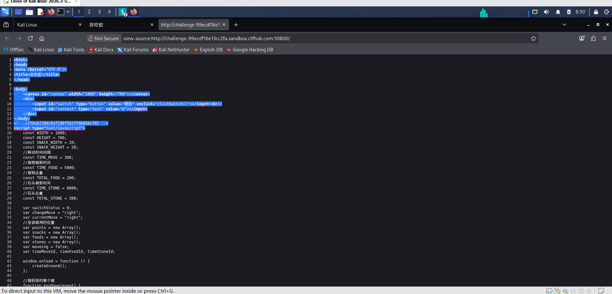

# WP：PHPINFO

> **CTFHub 路径**：技能树 → Web → 信息泄露 → PHPINFO
> **任务**：在 phpinfo 页面中找到 flag，并观察它泄露了哪些信息。
> **提示**：phpinfo 会输出大量 PHP 和服务器配置。用浏览器的查找功能搜索关键字，同时留意页面暴露的路径、版本、环境变量等信息。
> **截图要求**：能看到 phpinfo 页面、你搜索/定位到的 flag，以及至少一处敏感信息。

---

## 题目信息

| 项目 | 内容 |
| --- | --- |
| 环境地址 | http://challenge-99ecdf16e13cc2fa.sandbox.ctfhub.com:10800/ |
| Flag | ctfhub{298c9af106f562f70605bcf9}  |

## 解题过程

打开页面后是一个贪吃蛇的游戏，用ctrl+u打开网页源代码后找到flag。除此之外还暴露了前端代码，注释信息

## 关键请求/响应

```http
<html>
<head>
<meta charset="UTF-8"/>
<title>贪吃蛇</title>
</head>

<body>
    <canvas id="canvas" width="1000" height="700"></canvas>
    <div>
        <input id="switch" type="button" value="開始" onclick="clickSwitch()"></input><br/>
        <input id="content" type="text" value="0"></input>
    </div>
</body>
<!-- ctfhub{298c9af106f562f70605bcf9} -->
<script type="text/javascript">
```

## 原理与复盘

phpinfo 页面一般会暴露PHP版本，服务器操作系统，网站物理路径，环境变量，扩展信息等。攻击者利用这些信息手机服务器指纹，查找响应漏洞进行攻击

---

## 截图



> 可以在这份 WP 中另加过程截图；检查时只看指定图片，额外图片不检查。

